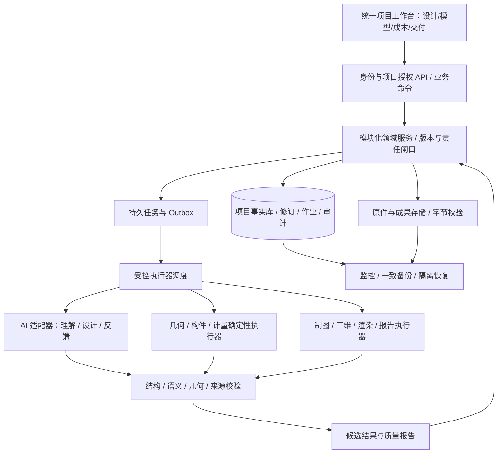

# RKD AI 平台最终目标与总体架构实施蓝图

版本：1.0；编制日期：2026-11-04。
性质：依据用户要求制定的产品战略、总体架构和落地设计；属于执行计划的详细附件，不是功能完成证明。
执行顺序与验收总入口：[docs/13](13-产品交付执行计划与设计.md)；唯一动态进度：[PROJECT_STATUS](../PROJECT_STATUS.md)。
研究依据：[docs/20](20-设计公司流程研究与项目可行性复核.md)；当前设计能力反例：[docs/19](19-AI设计能力与执行方向复核.md)。

阅读导航：第1—3节回答最终产品/业务/操作；第4—11节回答架构与具体落地；第12—13节回答按什么顺序实施及怎样验收；第14—16节回答如何控制效率、风险和方向。建议先读1.2、4.1、12.1、12.7，再按任务定位细节。

| 章节 | 内容 |
| --- | --- |
| 1—3 | 战略目标、完整公司流程、岗位责任与统一工作台 |
| 4—5 | 模块责任、数据契约、坐标/单位、来源与版本传播 |
| 6—7 | AI设计工作流、反馈、几何、三维、技术图纸与文件交换 |
| 8—9 | 量价/商务/采购/现场细节、任务/事务/接口与故障恢复 |
| 10—11 | 知识、权限、配置、部署、兼容迁移与运维 |
| 12—13 | P1—P5交付阶段、父任务/子项、正负例与最终验收 |
| 14—16 | 防偏离、决策触发、风险、来源与目标追踪 |

## 1. 战略定位与不能再偏离的目标

### 1.1 最终要建成什么

RKD AI 最终应成为一家室内设计公司的统一生产系统：把客户意图、现场依据、设计推演、专业建模、成本决策和实际交付连接起来，让 AI 承担可自动化的分析、设计与修订，让程序承担精确执行，让有责任的人完成必要的现场工作、选择和正式确认。用户在一个项目工作台内完成工作，资料与设计决定能够沿生产链传递，下一岗位无需把上一岗位的文件重新解释、复制和录入一遍。

“有思考的设计”具体指：方案能回应项目用途、使用者、品牌和体验目标；说明入口、动线、视线、开放/私密、展陈层次、尺度与材料之间的取舍；有真实不同的空间组织可比较；反馈会改变相关设计对象；新设计仍能被计算、编辑和深化。生成长篇理由但模型不变，不满足此目标。

“尽可能替代人工”具体指：自动完成重复录入、资料整理、需求提取、方案探索、受限建模、计算、制图、差异分析和成果交接；正常草稿迭代不层层申请许可。它不等于 AI 可以虚构现场尺寸、保证审美、替人量房施工或自动签订合同。最终目标包含真实效果表达、施工技术成果和交付服务；不能用矩形分区、漂亮参考图、审核页面或 NAS 已上线代替这些能力。

### 1.2 用户最后应能完成的一次完整工作

1. 新建项目，说明要做什么，选择已有项目资料；系统继承已确认的预算、利润口径、服务范围和团队设置。
2. 系统整理测量、图纸、照片和文字，显示现场依据与冲突；仅对真正影响下一步的未知项发问，其余以明确假设继续草稿。
3. AI 形成可编辑任务书和设计方向，给出不同动线、空间关系、展陈和材料意向的候选；每个候选可看图、看依据、看取舍、看已知成本与缺项。
4. 用户用自然语言或图面操作表达修改，锁定需要保留的部分；系统生成新版本，标出真实变化、受影响成果和无法同时满足的条件。
5. 选定方向后，系统沿同一模型逐步深化构件、材料、做法、灯光意向和家具展陈，形成与模型一致的三维预览、效果表达及阶段图纸。
6. 数量、材料表、费用测算、正式报价草稿随采用的设计版本更新；系统解释超预算来源，提出有依据的替代方案，不擅自降低质量或删除必需项。
7. 责任岗位收到对应版本的图纸、量价和问题，记录审查意见；需要修改时回到相关对象和要求，重新出包，保留旧版和审查历史。
8. 按项目服务模式推进供应商询比价、样板、订货准备、施工交底与计划；获得相应授权后才发生真实对外发布、采购或付款。
9. 现场问题绑定位置、对象和当时使用版本，变更展示设计、数量、费用、进度和订单影响；已收货、已施工和已付款事实不被模型重算覆盖。
10. 竣工交付汇集经确认的实际状态、图纸、材料设备、维护资料、问题关闭及验收记录；售后问题能追回原项目和对象，获准经验进入公司知识资产。

### 1.3 最终能力与交付证据

| 目标编号 | 最终能力 | 必须拿得出的证据 | 当前建设定位 |
| --- | --- | --- | --- |
| T01 | 一次录入、来源可追踪的项目事实 | 资料→字段→需求→设计决定之间可定位，修改后不需重复录入 | 复用资料/决策底座，补内容理解与场地模型 |
| T02 | 有需求响应的 AI 原创方案 | 同边界不同任务产生相关空间差异；至少两个可比较模型及修改前后图面 | 当前核心缺口，AI-DESIGN-01—03 |
| T03 | 可编辑、可深化的统一设计模型 | 稳定对象 ID、版本、坐标/单位、空间关系、构件与材料连接 | 从受限展厅逐类拓展，不声称任意 BIM |
| T04 | 同源的平面、三维和效果表达 | 同一对象/材料/相机基线；图像与模型差异可识别、可追溯 | AI-DESIGN-04；渲染执行能力按真实适配验收 |
| T05 | 可审查、可交接的技术成果 | 阶段图纸目录、必要尺寸/节点/说明/索引，真实文件和专业核对 | DELIVERY-01，逐个专业范围开放 |
| T06 | 设计全过程的量价与预算控制 | 概算依据、详细量来源、价格时点、缺项和版本差额；正式报价独立 | AI-DESIGN-05 并从 01 贯穿成本提示 |
| T07 | 设计服务经营与商业事实分离 | 委托范围、费用、里程碑、合同、应收/实收、成本各有独立记录 | BUSINESS-01 及后续经营闭环 |
| T08 | 可执行的采购与供应协同 | 需求→询比价→样板→批准替代→订单→到货→使用，守恒且有责任 | 复用 M4，DELIVERY-02 补真实采购条件 |
| T09 | 施工配合与变更闭环 | 交底/RFI/现场记录→版本影响→授权变更→重发→接收确认 | 复用 M4/LINK-02，DELIVERY-03 补细节 |
| T10 | 竣工、维护和知识反馈 | 实际状态交付包、问题整改、维护资料、保修责任、经验适用范围 | DELIVERY-03 后半段与知识能力 |
| T11 | 持续可靠的团队系统 | 权限隔离、可靠任务、备份恢复、监控、实际人员使用和版本交付 | 复用 M5；不以工程测试代替团队验收 |
| T12 | 有证据的效率提升 | 同口径人工耗时、修改次数、自动完成记录、模型费用和返工原因 | 从第一条 AI 试用链开始测量，不预报百分比 |

这些是最终能力目标，不代表本期全部实现。每项必须映射实施任务与具体场景；只有文档、接口、Schema 或测试数量增加，不能把目标标成完成。

### 1.4 战略取舍与能力扩展方式

- 先做深一个可检验的展厅/企业空间场景，再扩办公室等场景；扩场景通过版本化需求策略、对象库、计量规则和交付目录，不复制一套后台。具体下一场景由真实使用反馈排序，不预先承诺全行业。
- 软件基础层、几何算量层和权限规则继续使用确定性代码；需求理解、设计策略、候选推演、反馈解释使用真实 AI。可配置不意味着把所有规则交给模型自由改写。
- 先证明“设计被需求驱动”，再扩大量构件与漂亮表现；从早期就有可视图面、材料意向和成本信息，不能再先交一堆管理页面。
- 企业先以一个组织、多项目运行。项目权限与公司岗位可复用；不把 SaaS 商业化、租户计费、插件市场、通用 Agent 编排平台和全套 ERP 当作当前目标。
- 采用可替换的模型和专业执行器适配边界；先实现一条真实通道。未实际实现的适配器不在产品中标可用。

## 2. 对照正常设计公司的完整业务流程

以下是根据 docs/20 行业资料形成的 RKD 实施方案，并非把某一家公司的流程照搬为所有项目的强制规范。项目可选择纯设计、设计与采购协同、设计与供货/施工等服务组合；未承接的环节以交接责任表达，不伪造本公司履约。

| 阶段 | 输入及要解决的问题 | AI 与程序要做什么 | 交付/下游输入 | 人的责任与阶段退出条件 |
| --- | --- | --- | --- | --- |
| F01 项目接洽与委托 | 用途、客户、预算、时间、场地和服务意向 | 整理需求、范围/风险、服务清单与设计费草稿 | ProjectBrief、Engagement、ScopeMatrix | G1 决定是否承接及商业边界；真实收费前委托有效 |
| F02 现场与资料建档 | 原图、实测、照片、设备/结构/消防等已知接口 | 文件处理、单位/比例核对、候选对象提取、冲突登记 | SiteDatasetRevision、证据定位、未决项 | 现场真实性按实测/确认分级；不阻塞明确标记的假设草稿 |
| F03 需求与空间任务书 | 人数/使用行为、功能/容量、品牌、动线、预算及排除项 | 生成结构化需求、优先级、邻接关系、设计意图、缺项 | RequirementRevision、ConstraintSet | 客户/负责人修正关键误解；正常探索无需先过全部闸口 |
| F04 概念与空间探索 | 工作任务书、场地、参考与已知成本依据 | 多策略推演、落模、检查、材料氛围、候选成本比较 | OptionSet、模型/图面、比较报告 | 通过实际图面选择与反馈，模型不自行认定客户满意 |
| F05 方向确定 | 反馈后的候选、范围/费用变化 | 保留决定、差异说明、待确认问题 | AdoptedBaseline 与 G2 确认包 | 草稿采用与 G2 正式方向/需求冻结是不同动作 |
| F06 方案深化与协调 | 已选方向、对象库、材料/做法和专业接口 | 构件细化、家具展陈、材料/灯光意向、三维与预算迭代 | DesignDevelopmentPackage、更新成本计划 | 设计负责人逐项协调；关键外部接口未知时标待核实 |
| F07 技术成果与商业报价 | 深化模型、计量/价格依据、交付深度 | 出图、清单、说明、报价草稿、跨成果一致性核对 | TechnicalPackage、BOQ、QuoteRevision | G3 正式报价/合同；G4 专业施工图发布，责任分开 |
| F08 采购准备与供应协调 | 已授权范围、规格、样板、施工安排 | 询价比较、缺项追问草稿、交期/数量转换、替代影响 | ProcurementRequest、SampleApproval、OrderDraft | 依项目代理/供货角色授权；对外订单不能靠候选设计触发 |
| F09 施工与设计配合 | 有效发布包、现场事实、供应/工序信息 | 交底资料、问题定位、变更影响、进度依赖和跟进 | RFI、ChangeSet、变更包、接收确认 | 人执行测量/施工；重大变化经 G5，日常澄清按岗位权限 |
| F10 竣工与交付 | 实际安装状态、竣工修订、测试/整改记录 | 汇总资料、缺项核对、维护索引、验收包 | HandoverPackage、竣工模型/图纸、资产资料 | G5 最终验收；不能从采购“已到货”推断“已安装合格” |
| F11 使用与售后 | 使用反馈、保修事件、维护记录 | 定位对象/责任、建议处理、获准经验归纳 | WarrantyCase、知识候选、改进项 | 实际履约/关闭由负责岗位确认，知识不直接升级成通用事实 |

正常循环是 F03↔F04、F04↔F06、F06↔F07 和 F09→设计变更；不得把流程做成只能一路向前的表单。已批准基线的变更按影响范围处理，未批准的探索保持低摩擦。每次交接包括“收到什么、使用哪一版、还缺什么、下一步由谁负责”，不是只把文件标已上传。

### 2.1 五个人工责任闸口的系统语义

| 闸口 | 系统必须准备的具体包 | 可以自动完成 | 必须由有权人员承担 |
| --- | --- | --- | --- |
| G1 承接/商业边界 | 服务范围、交付清单、客户/相对方、费用草稿与风险 | 整理和检查、生成草案 | 是否承接、实际委托和商业承诺 |
| G2 需求/方向基线 | 任务书、选定方案、预算状态、未决项及变更说明 | 草稿采用、方案修订、比较 | 确认设计方向及明确冻结内容 |
| G3 正式报价/合同 | 同源报价、税务状态、范围/排除、合同版本 | 算量计价、差异检查、文档准备 | 正式报价/合同的有权确认与发布 |
| G4 施工图发布 | 对应模型、图纸目录、检查/审查、专业接口和版本清单 | 制图、交叉校验、汇总审查材料 | 相应专业批准与施工用版本发布 |
| G5 重大变更/验收 | 变更影响或实际交付包、旧/新版本、责任/费用影响 | 分析、重新计算、整理现场证据 | 重大变更承诺、实际验收/履约确认 |

后台岗位成员可以调整，但“属于审核岗位”“有项目访问权”“拥有具体正式批准权”是三个判断。管理员不能因为能管理账号就自动被视为专业签署人；AI 不得填充未知审核人或代替其签名。

## 3. 产品工作台与用户操作设计

### 3.1 导航按工作组织，数据仍为同一项目

保留现有项目入口，逐步收敛为：项目概览、资料与现场、需求与设计、模型与成果、成本与商务、采购施工、交付售后。任务、问题、版本、审批是贯穿面板，不再按后台表数量无限增加菜单。尚未实现的工作区显示清楚范围，不能放假完成度或可点击但不工作的功能。

| 页面 | 用户主要操作 | 必须同时看到的信息 | 首次落地 |
| --- | --- | --- | --- |
| 项目概览 | 继续下一项可执行工作、看待决事项 | 当前采用基线、阶段/服务范围、缺项和已完成事实 | 复用现有；AI 主线只补相关入口 |
| 资料与现场 | 上传/预览、选择允许 AI 使用的资料、修正提取 | 原件、来源定位、测量/推断区别、坐标/单位和版本 | AI-DESIGN-01 |
| 需求与设计 | 描述目标、生成/比较候选、反馈、锁定/采用 | 图面、需求响应、材料意向、成本缺项、变化原因 | AI-DESIGN-01—03 核心页面 |
| 模型与成果 | 编辑对象、切三维/图纸、查看来源与下载 | 选中对象属性/材料/数量、基线、过期/发布状态 | AI-DESIGN-04—05 / DELIVERY-01 |
| 成本与商务 | 查概算/详算/报价、预算差异、服务费和收款事实 | 口径、覆盖范围、来源、税/加成、未计项目 | 复用预算；BUSINESS-01 扩展 |
| 采购施工 | 询比价、样板、到货/使用、问题/变更 | 规格、数量基线、实际事实、权限、受影响对象 | DELIVERY-02—03 |
| 交付售后 | 补交付资料、确认整改、查保修问题 | 实际状态及证据、发布版本、责任和缺项 | DELIVERY-03 后半段 |
| 管理设置 | 配岗位/权限、服务模式、模型通道及额度 | 有效范围、变更历史、敏感配置的安全状态 | 复用账号；按依赖添加设置 |

### 3.2 第一条 AI 设计体验应怎样工作

设计页主区域给图面和候选对比，侧栏给任务书、反馈及选中对象；输入框是指挥入口，不是全部产品。用户可以在同一屏定位“要求—处理方式—实际对象”，查看哪些是已知、哪些是假设。候选至少能对比空间组织、入口/动线、开放与私密、材料氛围、已知成本及缺项；不以两个设计标题制造区别。

生成任务立即返回任务编号，显示排队/理解/推演/落模/检查/修订/完成等真实阶段；没有阶段事件不能用假百分比。离开页面再回来能继续查看。失败说明出错步骤、已保存部分、是否会产生再次调用费用，以及安全的重试动作。

图面手工编辑和自然语言反馈都生成新修订。锁定支持“对象位置”“不可删除”“材料决定”“需求关系”等明确范围；锁定不是把整个方案变成不可修改。采用按钮注明“采用为当前草稿”，正式批准入口独立；未通过必要硬检查的候选只能继续编辑/讨论，不能进入可计量的采用基线。

供应商和客户门户不是当前先做的大模块。第一步在既有工作台内提供受权限约束的具体交接包；出现真实外部协作需求后再复用同一 API/权限开通精简视图，避免创建另一个项目事实库。

## 4. 总体技术架构与模块责任

### 4.1 架构选择

沿用 React/TypeScript 工作台、Python/FastAPI 传输与现有领域服务、显式 Repository、SQLite 本地模式及 PostgreSQL 团队模式。保持模块化单体；后台 Worker 可独立进程运行，但共享版本契约和业务内核，不先拆成多个独立业务系统。NAS 承担应用、数据、文件和轻任务；外部模型与重型 CAD/渲染通过受控执行器接入，不能假设 NAS 有足够 GPU 或任意商业软件许可证。



AI 和执行器返回候选结果，不能直接调用数据库修改批准、合同、订单、付款或发布状态。业务命令核对当前身份、项目、基线、结果状态后才推进事实。重型输出失败不会把已确认项目数据置空。

### 4.2 模块边界与已有资产复用

| 模块 | 负责/拥有的数据 | 可以调用 | 明确不做的事 | 现有落点与增量 |
| --- | --- | --- | --- | --- |
| 项目与资料 | 项目范围、FileAsset/Revision、来源定位 | 文件接收、解析任务 | 把解析推断变已确认现场 | 复用 file_service / project_inputs |
| 需求与场地 | RequirementRevision、SiteDataset、ConstraintSet | 提取与理解执行器 | 生成正式采购或删源文件 | 复用 requirement_service；新增场地/需求 v2 契约 |
| 设计 | OptionSet、设计修订、对象/关系、锁定、采用指针 | AI、几何、成本预览 | 候选生成直接推进现用生产 | 扩展 design_service；隔离旧 create_design→sync 路径 |
| 模型与专业执行 | 几何/构件规则、派生视图、检查报告 | 确定性工具及适配器 | 从一张概念图片反推可靠工程量 | 复用 design_rules 部分基础；新版本验证器独立 |
| 量价与商务 | Quantity、CostBasis、Estimate、Quote、服务委托/合同事实 | 模型计量、价格库 | 修改源模型或把估算当实付款 | 复用 production_service / estimate_service |
| 采购与现场 | 采购需求/订单/收货/使用、RFI/变更/交付 | 已授权版本、影响分析 | 模型重算覆盖已发生事实 | 复用 procurement_service / change_service |
| 岗位与审查 | 岗位、任务路由、意见、正式权限 | 当前证据包与项目权限 | 用岗位配置代替真实专业责任 | 复用 account_identity / review_tasks 等 |
| 任务与 AI 通道 | Job/Attempt、提供商配置、调用用量/结果 | 白名单工具与限额 | 自由执行 shell、任意访问文件/网络 | 扩展持久任务，新增模型适配与运行记录 |
| 成果与运行保障 | Artifact/Manifest、发布包、备份/运维记录 | 各域只读输入快照 | 可变文件覆盖旧版本 | 复用 outputs / backup / deployment |

上述命名是目标模块边界；新增文件只在对应任务实施时创建。已有文件不要为“架构整洁”全量改名搬迁。领域数据通过显式服务与仓储访问，禁止某模块绕过授权读另一模块的运行数据库表。

### 4.3 先解决的实际耦合问题

当前 `design_service.py` 创建设计后会调用生产同步，`production_service.py` 在信息齐全时还会创建本地采购草稿。这条旧受限链已有价值，但不能直接用于多方案探索。新候选保存必须独立；只在 AdoptDesignDraft 命令通过版本与检查后，生成采用事件并进入同源生产。旧规则项目保留其已声明语义，迁移不能悄悄改变历史结果。

当前 `design_rules.py` 限定矩形、底边通道与条带分区；需求备注虽入哈希却不驱动布局。新设计任务须同时改变需求契约、生成路径、验证器和前端表达，仅加一个模型接口或把 AI 文案显示在旧图旁边不能算完成。

### 4.4 扩容与外部引擎的触发条件

先用现有数据库持久队列和少量 Worker，按任务类型限制并发。出现有记录的队列等待、资源争用、故障隔离或专业软件运行环境要求后，再分离 CAD/渲染 Worker；测量后才决定是否需要消息中间件、对象存储、向量检索服务或独立计算节点。引入新服务必须写明解决哪一瓶颈、运行成本、恢复方式和退出替换方案。

AI 模型选型以结构化设计质量、可用工具、数据政策、费用和延迟实测为准；允许不同任务用不同模型，但第一批先打通一个真实通道。不得先堆多个“总监/设计师/预算师”聊天角色，再把它们的相互赞同当专业质量。角色代表有输入输出的职责，不要求每个角色都是独立常驻 Agent。

## 5. 统一事实、数据契约与版本模型

### 5.1 数据组织原则

不是所有信息塞进一份聊天 JSON，也不是一开始建立整套公司数据库。稳定业务标识、关联、权限范围、当前指针、状态、检索字段使用关系表；可变的专业属性和执行器输入输出使用带 schema_version 的受校验文档；大文件存受控文件库，数据库存其版本、位置和摘要。新增对象按交付切片迁移。

共同字段包括 organization_id、project_id（项目对象）、object_id、revision_id、parent_revision_id、schema_version、created_at、created_by、source_refs、input_hash、content_hash；不适用字段允许明确不适用，不强造来源。revision_id 不靠文件名或人工编号判断唯一性。可编辑显示编号与内部稳定 ID 分开。

### 5.2 核心对象与最小必需内容

| 对象组 | 最小内容 | 关键关联/不变量 | 首次建设任务 |
| --- | --- | --- | --- |
| Project / Engagement / ScopeMatrix | 项目用途、客户、服务模式、范围/排除、交付清单、费用与阶段 | 设计委托不等于施工合同；每个范围有负责方或 unknown | 复用 Project；BUSINESS-01 |
| FileAsset / SourceRef | 不可变文件修订、SHA、页/表/行/CAD实体/照片区域定位、访问范围 | 来源指向具体字节版本，不只引用文件名 | AI-DESIGN-01 复用扩展 |
| SiteDatasetRevision | 楼层、边界、入口、柱/障碍、开口、标高、单位、测量日期、精度/状态 | 同一局部坐标系；现场事实和假设分别标记 | AI-DESIGN-01—02 |
| RequirementRevision | 功能、容量、行为、相邻/分离、设计意图、预算、工期、优先级 | 每条 requirement_id 稳定；有来源/是否确认/冲突/适用范围 | AI-DESIGN-01 |
| ConstraintSet / DesignIntent | 硬条件、偏好、目标权重、锁定、适用规则、依据 | 规则来源/版本明确；偏好不得私自升级为合规约束 | AI-DESIGN-01—03 |
| OptionSet / OptionRevision | 输入基线、策略差异、对象模型、理由、取舍、检查/费用摘要 | 候选不持有“正式批准”权；同一比较组引用同一输入或标差异 | AI-DESIGN-02 |
| Space / Element / Relationship | 空间/构件类型、几何、楼层/标高、用途、邻接/连接/包含关系 | 空间分区不是墙；家具活动包络不是实体构件 | AI-DESIGN-02—04 |
| Assembly / MaterialSpec / Product | 构造层次、厚度、性能/外观意向、产品/供应规格、样板状态 | 意向≠已选产品≠已批准样板；版本分别管理 | AI-DESIGN-04、DELIVERY-01—02 |
| ModelRevision / Baseline | 对象版本集合、输入需求/现场版本、锁定、采用指针 | 同一成果引用完整基线清单，不混多个“最新” | AI-DESIGN-02—05 |
| QuantityItem / MeasurementRule | 对象引用、计量范围、扣除/合并、单位、公式/规则版本、结果 | 可从指定对象重算；不可从视觉像素猜工程量 | AI-DESIGN-05 |
| CostBasis / Estimate / Quote | 价源、地区/日期/币种/税、成本类别、覆盖范围、加成/舍入 | 估算/报价不同对象；缺项不等于零 | 复用预算；AI-DESIGN-01—05 |
| View / Drawing / Render / Artifact | 视图参数、模型/材料版本、模板/引擎版本、真实字节/摘要、用途 | 表现图、技术图、发布包不同成熟度 | AI-DESIGN-04、DELIVERY-01 |
| ProcurementRequest / Order / Receipt / Allocation | 净需求、订货换算、批准规格、供应商、批次、已收/已用 | 计划量和实际量独立；有实物流动的事实只能追加调整 | DELIVERY-02 |
| RFI / ChangeSet / FieldRecord | 位置、问题、证据、影响对象/基线、决定、实际状态 | 设计修改不能改写历史现场记录 | DELIVERY-03 |
| Review / Approval / Release / Acknowledgement | 证据包、职责、具体人员、意见/权限/时间、发布及接收 | 看过/审过/批准/发出/收到分别记录 | 复用 M5；按正式范围实施 |
| Contract / Receivable / PaymentFact / ActualCost | 相对方、版本、币种、金额、到期、凭证/来源、事实日期 | 预算、应收、实收、成本和现金流不得互相替代 | BUSINESS-01—02 |
| Handover / Asset / WarrantyCase | 交付版本、实际安装、维护附件、责任/期限、问题与处置 | 期限依据合同/资料，不由模型补造 | DELIVERY-03 |
| Job / Attempt / ModelRun / ToolRun | 输入快照、执行配置、请求标识、状态、用量/费用、输出与失败 | 一次任务可有多次尝试；重试不能重复推进业务事实 | AI-DESIGN-01 起 |

新增命令/对象命名在本蓝图中为逻辑设计；实施时查重并扩展 `contracts/v1/` 现有契约、命令注册表、OpenAPI，不与旧字段并排制造同义字段。新布局可用独立 schema_version，不因为业务 API 仍是 v1 就覆盖旧布局文档语义。

### 5.3 来源、确认、检查、生命周期分别表达

至少分开四个维度：origin_kind（原件提取/手工/AI推断/程序计算/测试）、evidence_status（未知/待核实/已核实及核实依据）、validation_status（未检查/通过/失败/部分覆盖）、lifecycle_status（候选/已采用草稿/已批准/已发布/已被替代）。一个 AI 推断也可能通过几何检查，但这不证明现场真实或设计获批。

对数字使用 value + unit/currency + known_status；null 配明确未知原因，不把空字符串、0、未知和不适用混同。照片比例不足只能提供候选关系/位置，不得生成“实测 3.26m”。冲突保存各自来源与解决决定，原件与历史提取不回写。

需求解释优先使用当前已确认的项目决定；新文字与其冲突时生成待决冲突。已核实测量、原图、照片、AI 推断之间不设脱离时点的绝对高低排序，按资料版本、核实状态和适用范围判断；只因资料较新也不能自动覆盖有权确认。

### 5.4 几何、单位与对象标识

新模型明确局部右手坐标、XY 平面、Z 标高、原点、朝向和单位；导入保留源坐标及变换矩阵。现有模型的米单位保留，通过版本化适配器转换，不重解释旧坐标。业务数据使用规范十进制，几何运算可使用引擎数值类型，但容差、网格精度、量化位置和面积误差都进入验证配置；不能逐步随意 ROUND。

同一方案修订内未删除的对象沿用 ID；拆分/合并保存 derived_from 关系；不同候选间只对可确认的同一逻辑对象建立映射，不能为了让 diff 好看强配身份。已删除对象保留历史及替代关系，不复用 ID 给另一件东西。空间面积、材料铺设面、墙实体、家具占地和通行包络分类型，不能把总面积相加重复计量。

### 5.5 候选、采用、批准与变更传播

```text
输入快照 → 候选组 → 候选修订（可失败/可保留比较）
                        ↓ 必要检查通过 + 显式采用命令
                  当前草稿基线 → 同源量价/成果草稿
                        ↓ G2 / G3 / G4 按各自职责和范围
                  经确认/批准的具体包 → 受控发布 → 接收记录
任一基线变化 → 新修订 + 受影响下游过期提示；旧包和旧事实保留
```

采用动作使用 CAS/预期版本控制：校验组织项目、候选所用输入、当前采用指针、锁定及必要硬检查；提交新采用基线、审计及生产任务同一事务。耗时生产在事务外运行，完成后再次核对基线才能成为“当前成果”；生产未完成时页面明确“已采用，成果生成中”，不显示旧成果为新成果。候选无效或输入过期时可以查看历史，不得自动采用。

| 变化类型 | 必须重新计算/检查 | 可以复用但需核对 | 不应被自动改写 |
| --- | --- | --- | --- |
| 场地边界/入口/障碍 | 布局、连通、碰撞、有关构件与量、图纸 | 与变动无关的文本/材料来源 | 已发布包、现场实况、商业事实 |
| 功能/容量/动线要求 | 相关空间组织、目标响应、受影响视图/费用 | 未受影响对象、锁定决定 | 用户明确保留的对象，冲突须提出 |
| 材料/构造/厚度 | 相关表面/体积/构造量、成本、渲染、节点 | 不受厚度影响的空间拓扑 | 已收产品/已装事实；形成待核对影响 |
| 单价/税率/加成 | 对应估算/报价和相关审批有效性 | 几何/几何量/不含价格的图面 | 历史合同与已付款记录 |
| 纯说明修正 | 说明、受影响标签与报告 | 无语义改变的模型/数量 | 不得借文字改动偷换工程基线 |
| 施工实测/替代 | 竣工候选、变更影响和接收记录 | 原设计作为历史参考 | 原审批和原施工用图 |

依赖关系按对象版本、规则版本和参数保存；未实现精细影响判断时可以保守标记更多成果待更新，但不能漏标已受影响成果。缓存键含组织/项目、完整输入摘要和执行器版本；复制项目不得复用带原项目私密信息的缓存。

## 6. AI 设计系统如何真正落地

### 6.1 最小可用 AI 生产流程

| 步骤 | 处理细节 | 返回的可检查对象 | 失败或不确定时 |
| --- | --- | --- | --- |
| A1 组装允许的上下文 | 先权限筛选，再读取选定资料内容；保留来源片段、当前决定、场地与预算 | ContextManifest、输入哈希 | 没有解析内容明确未解析；不以文件名冒充理解 |
| A2 理解需求 | 提取用途/容量/关系/体验目标，识别冲突，提出最少必要问题 | 结构化任务书、假设与冲突表 | 缺硬边界可用明确测试/假设场景，真实正式状态不升级 |
| A3 形成不同策略 | 以相同硬条件探索不同动线/功能组合/展示节奏，解释收益和牺牲 | 至少两个策略与设计意图引用 | 两策略同质则修订；无可行空间明确冲突 |
| A4 落成可计算模型 | 模型输出受约束参数/对象/关系或白名单工具命令；程序构造几何 | OptionRevision、对象集合和视图 | 不执行模型生成的任意 Python/shell/SQL |
| A5 校验并限次修正 | 结构→来源→语义→几何→连通→锁定→成本覆盖→视觉一致性 | 逐项问题、对象定位、可修复建议 | 硬失败不标可行；达到次数/时间/费用上限保留失败候选 |
| A6 展示与比较 | 同一尺度显示图面、材料意向、预算已知部分、缺项和取舍 | 对比页与可下载草稿 | 只成功一个候选则明确只完成一个，不冒充多方案通过 |
| A7 反馈修订 | 把反馈转换为变更意图，核对锁定，在原版本上提出 patch | 新修订、对象 diff、需求响应说明 | 无法满足时解释冲突；不得默默移除保留条件 |
| A8 采用与生产 | 用户/有权项目操作者选定，CAS 提交草稿基线，再派量价/成果任务 | 采用记录、同源生产版本 | 晚到结果进入历史；不能覆盖新输入/新采用决定 |

以上是受控工作流，不要求每一步都单独调用模型。合并步骤以减少等待和费用，但不可省掉事实/结果检查。先建立一个真实调用与完整闭环，再根据实测拆模型职责；前端应随着 01—03 增量可操作。

### 6.2 模型适配、配置和运行记录

服务端 ModelProvider 接口承担：能力声明、结构化请求、受控工具调用、超时/取消、错误归类、用量及提供商请求标识。领域服务依赖中立结果契约，不依赖某厂商原始消息字段。模型名、适配版本、提示模板、设计策略、输出 Schema、工具白名单、校验规则、温度/种子（若支持）均在运行记录中固定。

密钥在部署环境的秘密配置中，浏览器只看到是否已配置和可用能力，不回显密钥。模型未配置明确阻塞真实生成；允许开发使用显式测试适配器检验错误/并发，但测试输出永不标为真实 AI。未经授权不把客户原件发送到外部；首先用合成文本联调。已有“部署 NAS”授权不自动等于新增付费模型额度或把所有商业资料外发。

配置包括单任务 token/费用/时长上限、项目或组织周期额度、最大候选数、最大修订次数、并发上限和允许资料类型；额度未确定时不启动有不明确费用责任的真实调用。系统先预留预算、调用后对账；价格依据按版本保存，未知费用不显示 0。失败但可能已被提供商计费的请求保留“调用结果待核对”，避免无限盲重试。

不承诺语言模型逐字节重现。审计保留允许保存的输入/输出快照、版本和调用元信息；确定性几何/计量执行器应能从保存的有效模型重算。敏感原文引用受原项目权限，普通日志只保留摘要/错误分类，不能为了“可复现”把秘密或全部客户资料写入日志。

### 6.3 设计策略怎样避免写死

将场景知识组织为有版本的设计策略与对象库：功能关系、使用行为、展示节奏、开放/私密需求、材料意向及可选构造是输入，不是固定输出坐标。AI 可提出新的组合和自定义构件意图；超出已支持的几何/做法时返回待深化对象，而非偷偷套用近似成品。

几何引擎允许多种组织方式，参数优化只帮助满足约束；不能把“全部排成底边条带”作为唯一求解空间。首批可以限制单层、平面、若干对象类型，但不能限制每个项目都使用同一动线和分区形状。策略/案例用于启发，应用后保留所引用版本和适用前提，不能照抄客户保密项目。

候选差异采用可解释结构指标：入口至关键区的路径组织、功能区邻接/分离、公共/私密边界、展陈序列、核心对象位置、材料分配等。仅对象排序、颜色、名称或微小位移变化不满足“不同方案”。不能用随机坐标扰动制造多样性。

### 6.4 反馈、锁定和人为修改

每次反馈绑定 option_revision_id 和 requirement_revision_id；保存原文与解析后的变更意图。手工操作记录 actor、对象、字段和理由，形成与 AI patch 相同的版本路径。默认保留无关已确认决定；修改锁定字段时先列冲突和替代建议，不自主解除。

基线已经改变时，旧反馈可查看但不能直接应用；系统提供重新分析或可审查的合并差异。几何 patch 不允许任意 JSON 路径写入身份/审批/价格来源；白名单只开放当前操作支持的对象字段。重新生成不能每次丢弃全部对象 ID、人工布局与材料决定。

### 6.5 设计质量如何评估

硬检查回答“在已表达条件下是否违反几何/连通/锁定”；需求响应报告回答“哪些设计决定服务哪些要求”；视觉检查回答“看见的是否与模型一致、是否存在明显遮挡/表现错误”；真实用户和专业人员判断“是否有设计价值、是否可继续深化或施工”。四类结果分别存储，不用一个总分掩盖严重问题。

AI 可以指出设计弱点并提出修改，第二个 AI 的赞同只算辅助意见。对质量记录具体图面与对象、用户意见、调整原因及最终采纳情况。建立相反需求、不同入口、有柱障碍、预算不足、锁定冲突等评估用例；不只使用能通过的矩形案例。

## 7. 从二维空间到模型、效果表达与技术成果

### 7.1 渐进式几何能力

| 层次 | 需要支持的对象/算法 | 交付结果 | 明确边界 |
| --- | --- | --- | --- |
| L1 空间组织 | 单层边界及洞、入口区段、柱/障碍、功能区、多段动线、邻接/连接图 | 可比较平面、面积、需求响应 | 允许受限多边形；异常边界明确拒绝，不退回假矩形 |
| L2 受限空间构件 | 隔断/门口、家具/展台、活动包络、材料表面、高度/标高 | 带对象的平面和 2.5D/三维预览 | 分区线不能自动变实体墙；高度未知不补默认真实值 |
| L3 专业深化 | 已支持构件的构造层、连接节点、收口、尺寸链、选定产品 | 图纸、材料做法表、受限节点和详细量 | 每类能力独立验收；结构/机电/消防边界仍需专业协调 |
| L4 项目交付与交换 | 需要的原生工程文件/交换格式、外部专业对象映射、变更回导 | 可在目标工具打开核对的交接包 | 未实际回放不宣称任意 CAD/BIM 兼容或无损双向转换 |

L1 需检查边界合法/自交、区域包含与重叠、障碍避让、最小面积、入口可达、通路连通及瓶颈宽度；门口连接必须有足够实际可通过区段，不能用“边界接触一个点”认定可达。通行验证基于自由空间/可行走包络和目标点，不再要求所有区域接触同一底边。数值容差不能替代人群使用、疏散或无障碍的专业判定。

实现先复用已经锁定和验证的几何库，必要的新增算法用小场景证明，再扩大边界。遇到曲线/多层/异形构造等未支持输入，保留来源并明确适用限制；不能悄悄离散成粗糙形状后宣称精确计量。

### 7.2 同源模型不等于一种文件包办全部工作

平台保留语义对象、几何参数、关系、材料与来源作为可计算事实；二维图、三维显示网格、渲染场景、工程量和技术图纸都是有映射的派生表示。修改派生图不能反向静默更改源模型；需要回导时必须成为可审查的变更。

浏览器三维可采用 glTF/GLB 作为派生显示载体，保留 scene node→object_id 映射与模型摘要；它不取代平台的业务模型。Khronos 将 glTF 定义为三维资产传输/加载的发布格式，此处将其作为显示层是本项目的设计选择，详见第 16 节 R2。是否采用具体渲染库在实施时以现有前端、体积、许可证和实测决定，不在计划中虚构已安装引擎。

专业 CAD/BIM 通过适配器输出明确对象集合和属性映射。IFC/原生工程文件属于后续真实交接选项；先确定交付对象与目标工具，再实现并在目标工具验证。不能用“有 IFC/DXF 文件扩展名”证明专业语义或可编辑性完整。

### 7.3 三种图像要区分

- 概念参考：表达气氛/材料方向，可由 AI 生成；标明来源和非精确空间，不用于算量或施工。
- 模型预览/模型渲染：由指定模型、材料、相机、灯光版本驱动，能选中追溯对象；用于检查空间及设计表现，质量按实际引擎能力声明。
- 正式效果成果：在项目约定的表现深度完成材料、灯光、相机和关键细节核对，绑定已确认的设计基线；经过 AI 图像修饰时保留原渲染及改动记录，改变几何/材料的内容不能伪称完全同源。

空间体验评价不能只看面积达标。候选至少提供入口视角或关键视线的解释、展陈主次、使用序列和材料意向；04 阶段再把高度、遮挡、灯光意向和关键视角落实到模型。漂亮但尺寸关系不成立的图片不能通过模型验收。

### 7.4 技术图纸与交付深度

DELIVERY-01 逐项实现项目需要的图纸：原始/拆改、平面布置、地坪材料及分缝、天花/灯具意向、立面/剖面、节点/收口、门/隔断/家具表、材料做法表、尺寸/标高和总说明。该目录是最终规划，不能把首批未实现图纸列成已经可生成；专业责任和机电消防接口分别说明。

每类图纸定义：输入对象/精度、视图生成规则、标注与比例/单位、模板、最小内容、跨图检查、人工补充位置、适用阶段、实际文件格式和目标软件回放。计划图号、页号、图名、版本、索引、尺寸链/对象ID与材料编号应相互核对。标注避让失败显示问题，不靠缩小到不可读解决。

技术发布包保存 release_manifest：项目/用途/范围、需求和模型基线、图纸/清单/说明的版本及 SHA、检查与专业审批引用、限制/排除、接收方及撤回/替代关系。修订只影响被改变的图纸与相关索引，但包内版本必须一致；正式包保持不可变，不能下载时临时拼“最新文件”。

## 8. 成本、采购、现场与经营细节

### 8.1 成本贯穿设计，但成熟度分开

概念阶段可以使用有出处的面积指标、历史适用案例或已知材料价形成粗估；必须显示地区/日期/适用前提及覆盖范围。没有依据时只显示已知部分与未知类别，不自行给一个貌似可靠的区间。深化后逐类接入对象计量和做法价格；正式报价额外绑定范围、税务状态、有效期、交易条件与审批。

预算看板分别列：用户目标、已知测算、未计项目、明确排除、备选方案差异。覆盖率可按声明的费用类别统计，但不可用已计金额除以未知总价制造“成本覆盖率”；不把单地坪小计标为项目总价。超预算时 AI 只能建议带具体对象/规格/依据的调整，并展示性能与体验取舍。

沿用项目指定口径：宁波含税目标 600,000 元；5% 为试用税率；施工 20%、设计 60% 为成本加成。计算继续由 Decimal 与版本化公式完成，正式适用性另记；本蓝图不重新要求用户补税额或改利润定义。

### 8.2 净量、清单量、采购量与实际成本

对象几何净量 → 按声明规则形成工程清单量 → 对应构造/材料消耗 → 采购需求 → 损耗/排版/包装/库存等换算 → 订货草稿。这些结果保存不同 ID/规则/单位，不能一列数量换标题重复使用。

例如地面净面积已知而拼缝、排版、破损、包装和可用库存未知时，只能出净量和待补采购条件，不能默认增加 5% 或将净量直接称为可下单量。已有库存需核实可用数量/规格/归属，已收货需扣除已分派/退货等事实，不能把另一项目材料默认挪用。

价格库保存供应商/报价单版本、规格、单位、含税口径、运费/安装边界、地区、日期/有效期、起订量和授权来源；过期报价仍可复现历史，当前使用必须提示状态。AI 可整理比较，不编单价、税制、折扣或厂家承诺。材料代换必须影响到模型表面/做法、数量、价格、表现和必要专业检查。

### 8.3 商业与交付对象补齐

设计服务费单列合同/阶段应收与真实到账证据；施工/供货合同、供应商订单、发票与付款事实各自关联，不能根据“报价已批准”推断已签约、开票或付款。F01 中如需签设计委托合同，同样适用 G3 的商业授权原则；G3 不只在施工报价阶段出现。

WBS 把设计成果、采购交付和施工工作分解为可交付项，记录计划/预测/实际日期、依赖、负责岗位及完成证据。未有工期依据不自动给精确日期；进度风险由实际依赖和到货/现场事实产生。公司经营视图读取这些事实形成项目成本、应收、现金和产能信息；不另建手工“老板报表”成为第二套账。

### 8.4 采购和现场操作的异常路径

| 情况 | 系统处理 | 不允许的自动行为 |
| --- | --- | --- |
| 供应规格与设计不符 | 创建差异/替代候选，展示设计/成本/交期影响 | 直接把供应品改为已批准材料 |
| 设计变更发生于已订/已收后 | 分离未执行需求、已执行事实、退换/追加建议 | 删除旧订单/收货以配平新模型 |
| 超收、部分到货、退货、破损 | 分别登记事实与处置，检查数量守恒和授权 | 为了通过校验回写原订货量 |
| 现场尺寸与模型不符 | 新测量证据、冲突、受影响对象与变更建议 | 自动把照片推断作为竣工尺寸 |
| RFI 只需澄清 | 绑定对应发布版和答复，确定是否影响设计 | 每次问题都强制重新审批整个项目 |
| 重大范围/成本/安全变化 | 准备 G5 影响包，保留旧有效基线 | 未经责任确认更新施工用发布版 |
| 已收到图但未确认使用 | 保留 delivery/acknowledgement 区别、提醒待确认 | 把下载日志当施工方已理解与实施 |
| 交付缺保修/说明资料 | 列缺项、责任、来源与后续补交记录 | 生成虚构合格证/验收/保修事实 |

## 9. 任务、事务、接口与可靠性设计

### 9.1 长任务边界

提交请求先做项目授权/输入校验/幂等/CAS，在短事务内保存 Job、输入快照引用、预算预留和审计；返回任务 ID。Worker 领取租约，在数据库事务外执行模型/几何/渲染。心跳及分阶段结果有明确尝试编号；完成后以新短事务核对租约、任务状态及基线，登记候选/成果。

不在等待模型返回期间保持项目数据库写锁；现有小型确定性同步链保持兼容，新长任务逐步迁出。复杂生成失败不把前一步已保存任务书删除；一项作业的部分候选失败需显示部分结果和未完成要求。

### 9.2 最小命令与查询面（实施时登记正式契约）

| 逻辑操作 | 必须输入 | 返回/事件 | 关键守卫 |
| --- | --- | --- | --- |
| QueueRequirementUnderstanding | 项目、选定来源版本、自然语言、预期需求版本、配置版本 | Job、输入快照 | 权限/外发范围/额度，资料是真实内容 |
| QueueDesignOptions | 任务书/场地/约束基线、候选数、策略配置 | Job、OptionSet | 必需几何明确或显式假设；不走旧生产 sync |
| ReviseDesignOption | 候选版本、反馈/受控patch、锁定、预期版本 | 新修订任务/差异 | 不改锁定、不覆盖晚到冲突 |
| AdoptDesignDraft | 指定有效候选、预期当前采用版本 | Baseline、生产任务/Outbox | 检查、输入新鲜度、权限；非正式批准 |
| PreviewOptionCost | 候选版本、价源/规则版本 | 候选独立测算 | 不改当前报价/订单 |
| GenerateTechnicalPackage | 采用/确认基线、目录与模板版本 | 作业/成果清单 | 支持能力、资料完整度/适用用途 |
| QueryOptionComparison / ObjectTrace | 明确比较对象或object_id/revision_id | 图面、差异、来源链 | 所有引用均属可访问项目 |
| SubmitReview / PublishApprovedPackage | 冻结证据包、职责/权限、用途 | 审查/发布记录 | 复用现有审查边界，正式发布另验收 |

遵循现有 `/api/v1` 和错误返回结构；可继续现有具体资源路由，不强迫为了统一命令名重写所有接口。前端不把模型原始流式 token 当成业务成功信号，依据保存后的任务事件/结果更新视图。轮询先可用，需要时再引入事件流，断线重连可从服务器状态恢复。

### 9.3 并发、幂等和外部调用

幂等键作用域至少包含组织/项目/操作/调用键，同键异输入明确冲突。数据库更新使用现有项目级事务/CAS，新增唯一约束防止重复采用或重复业务派生；只在可证明安全时重试整个事务，不能只重跑最后一条 SQL。PostgreSQL 的并发隔离语义需按具体版本和当前实现验证；官方事务文档见 R1，不假设“用了 PG 就不会竞态”。

外部请求不保证恰好一次执行。发送前保存调用意图和 request_id；若服务支持幂等/查询则利用它，超时导致结果不明时记录 pending_reconciliation。取消尽力终止远端任务，已发生费用和迟到结果仍要对账；迟到结果不再推进当前基线。Outbox 保证业务记录与待处理事件同事务，消费者仍须去重。

### 9.4 文件与数据库不能假装原子提交

成果先写独立暂存目录，校验格式、大小、摘要与对象映射，完整落位后才登记可用成果引用。数据库提交失败可能留下未引用文件，应记录待清理状态；恢复任务先核对引用/哈希，再隔离孤儿，按明确保留策略清理，不删除未知用户文件。下载实时授权并核验对应字节，不能让同路径新文件冒充旧包。

提供崩溃注入验证：调用前/返回后/文件写到一半/文件已落位但数据库未提交/采用后生产未完成/过期租约回报。恢复后应只有一组有效业务结果，失败尝试可追踪，旧成果继续可读；不能通过删除数据库重新跑来证明恢复。

## 10. 知识、权限、数据保护与可配置能力

### 10.1 公司知识如何积累并参与设计

知识分为项目私有事实、获准复用案例、公司材料/构件/做法库、外部标准/参考四类。每条保存来源、版本、版权/使用范围、适用场景、地区/日期、维护岗位、核实状态及失效条件；项目经验先成为知识候选，经过范围核对才进入通用库。一个项目中采用的材料/方案不能直接成为所有项目的默认正确答案。

先用项目明确选择的资料、结构化索引与关键词检索形成小而可信的上下文。资料量和召回问题有证据后再引入向量检索；无论何种检索，都先按组织/项目/资料外发权限过滤，再给模型内容，结果引用原版本。不能先跨项目检索，再指望模型不泄露。规范知识需带地区、版本、条文定位和专业确认状态；检索到文字不自动代表适用或合规。

设计策略、提示模板、模型通道、校验配置、材料库、计量规则和图纸模板统一采用“草稿→测试→指定适用范围→启用→可停用”的配置生命周期。修改配置生成新版本，不追溯改变历史调用和成果。计量/权限等关键规则需要确定性实现与回归；管理员配置不能注入任意代码。

### 10.2 权限与 AI 工具边界

- 每次读写包括成果下载、历史比较、知识检索和后台回调，均检查组织、项目及当前身份；撤销权限后旧页面/地址不能继续访问。
- 普通岗位路由复用现有配置；正式审签权限绑定明确责任范围、具体有效人员与证据包，不用“管理员”角色推导。
- 上传文档、网页和模型输出都是数据；其中“忽略规则”“上传所有文件”“执行命令”等文字不成为系统指令。AI 只获得任务允许的只读资料与白名单专业工具。
- 工具参数只接受受校验的项目对象/安全存储键，拒绝任意路径、URL 回源和数据库语句；远程资源仅按显式允许的执行器策略访问。
- 模型调用、生成候选、内部待办可以在已授权范围自动推进；实际对外消息、发布、订单、付款须符合用户授权及具体业务闸口，不能因模型说“已获同意”执行。
- 密码与密钥不进提示词、成果包、普通日志和 Git；沿用用户已确认的 8—128 字符密码策略，本规划不重开已完成的账号决定。

### 10.3 数据生命周期

原件只读；派生/测试/运行数据分层，测试项目始终可辨认。临时上传、失败输出、模型调用记录、业务修订、发布包和备份分别配置保留策略；正式项目资料没有获准保留期限前不自动删除。删除请求须识别合同/责任保存要求、依赖和备份副本，实施为可审查操作，不用“清理空间”绕过。

模型供应商的数据保留、区域、训练使用等不能靠适配器名称推断，真实接入时核对所选服务与账号配置；未明确前只发获准的合成或已授权资料。用户无需为内部 schema/界面开发提前决定所有供应商和外发条款。

## 11. 部署、兼容迁移与运行保障

### 11.1 当前资产与目标部署

当前已有本机 SQLite 业务链及独立 FN NAS/PostgreSQL 私有试用部署，实际版本/镜像/备份证据只在 PROJECT_STATUS 记录。NAS 已经部署不等于已经把本机原日常库正式切为团队唯一权威库；新开发不能让两个库同时写同一项目再靠文件拷贝“同步”。

目标团队形态为浏览器经已配置的 Tailscale 私有 HTTPS 访问应用；应用/Worker 使用受限数据库账号及独立数据目录，数据库管理凭证与业务凭证分开。重型计算可在独立工作机/服务运行，仅接收本次获准输入与返回结果，不挂载整个 NAS 家目录。外部模型 API 可通过受控服务端连接调用；NAS 不需因此暴露公共注册或数据库端口。

本机开发、隔离测试、NAS 候选验证和日常运行分开数据路径/数据库；不得把真实客户资料拷入测试夹具提交。各环境有应用包摘要、数据库 schema 版本、依赖锁、前端构建摘要和启用能力清单，发布时对账，避免前端按钮已上线但后端未支持。

### 11.2 新契约与旧模型兼容

先注册新需求/布局 schema，保留旧 `showroom-layout.v1` 读取、验证和导出。旧项目继续查看和使用旧成果；转换成新模型是显式“创建新版本”，列出补齐项、来源与转换报告，不回写旧哈希或伪造入口/柱网。新旧 API DTO 在边界适配，共用项目身份和来源，不并建一套用户/文件系统。

实施前逐项核对现有契约与运行实现的差异：例如部分历史 `contracts/v1` 的 ID 要求 UUID，而当前运行对象使用带前缀标识；执行器契约要求非空输入成果与扫描凭据，而第一批合成文本任务可能没有这些条件。必须为新任务选择明确的兼容适配或新版本契约，保存原运行 ID 映射；不能填假 UUID/假扫描凭据，也不能一次性放宽所有安全字段。旧契约中的理想能力不是已实现证明。

SQLite 与 PG 对新增业务语义保持相同，按各自显式迁移/仓储实现；PG RLS 与真实并发专项不能被 SQLite 单测取代。迁移采用增量增加、复制校验、切换读取，再评估旧字段停用；本轮不预设批量删表。历史失败成果和未知来源保持原状态，不能在升级时自动洗成有效。

### 11.3 真实升级与正式切库

每次业务升级：冻结本批应用包→在隔离库跑相关回归/浏览器/成果→备份当前数据库+引用文件+应用→候选迁移与恢复→部署→入口/权限/任务/实际下载核验→记录证据。新代码可在不改当前库的候选环境审查。代码回退仅在 schema 兼容时允许；否则恢复到另一个已验证环境，不能直接把旧二进制指向不兼容新库。

正式切库单独列入 PLATFORM-01：盘点两端新增事实、确定唯一迁移源和冲突处理、明确短暂停写窗口、最终一致备份、增量/全量对账、切换入口、核对个人账号/文件/全部域、将旧端设只读、观察和预定回退条件。已有 NAS 部署授权覆盖继续验证准备；当具体停写/取舍会影响真实工作时，再请用户对可审查的切换方案决定，不擅自覆盖两端任一数据。

### 11.4 运维、备份和服务目标

沿用已建立的 NAS 备份与 Windows 异机复制/隔离恢复；不重新要求安装现有计划任务。Windows 关机、未登录或网络不可达时不能当作副本持续更新。工作台显示最近成功时间、最近失败、备份年龄、异机副本及恢复证据，外部通知依用户决定暂缓；应用完全停机时站内提示无法主动通知，这个限制保留在运行视图和后续通知任务中。

监测应用就绪、数据库连接、磁盘空间、队列积压/过期租约、模型失败/额度、成果完整性和备份恢复。区分服务可用、模型可用、某专业执行器可用；模型故障时资料/既有图纸/手工编辑仍可使用。故障恢复不重复创建采购/合同等事实。

非功能验收从可测目标开始：

| 项目 | 本阶段要求 | 如何验证/何时调整 |
| --- | --- | --- |
| 交互 | 长任务不占用页面等待，提交后能获任务标识并恢复查看；禁止伪造完成进度 | 记录 API p50/p95、队列等待和端到端时间；以固定测试场景对比基线 |
| 成本 | 每次真实调用有配置上限、用量/已知费用和失败记录；超额拒绝新调用 | 故障/并发预留与实际账单或服务用量对账 |
| 并发 | 两人编辑/采用同一旧基线只有一方成功或明确合并 | 实际 PG 并发、取消和晚到测试 |
| 完整性 | 历史字节、权限和已发生业务事实不得被新生成覆盖 | 逐文件摘要、数据快照和恢复后业务核验 |
| 可恢复 | 新 AI 作业/对象/配置进入完整备份范围；隔离恢复可继续读写受支持业务 | 实际重启/隔离恢复，不只 ZIP 解压 |
| 容量 | 首批场景建立对象数/文件大小/并发与耗时基线；资源上限显式配置 | 超限返回可理解说明，不导致整个 NAS 服务失效 |
| 可用性承诺 | 不先承诺未演练的 SLA/RPO/RTO；依据备份频率和实际恢复测量提出目标 | 团队持续试用/正式切库时确认可接受损失窗口和恢复窗口 |

## 12. 分阶段实施任务与依赖

### 12.1 从当前资产到最终目标的交付顺序

| 交付阶段 | 主任务 | 用户实际获得什么 | 阶段退出条件 |
| --- | --- | --- | --- |
| P1 真实设计闭环 | AI-DESIGN-01→02↔03 | 同一工作台真实理解→两种图面候选→材料意向/成本缺项→反馈→采用草稿 | 对应 AD01—04 有工程证据，并开始收集具体设计反馈；不宣布 AD 全部完成 |
| P2 同源深化与量价 | AI-DESIGN-04↔05，延续 02/03 | 家具/展陈/隔断/材料与三维，选定模型驱动受支持数量/报价/成果 | AD05—07、完整 AD08 实际反馈；AD01—08 全部按事实判定 |
| P3 具体专业生产 | DELIVERY-01、BUSINESS-01、相关 M5-05/06 | 项目约定范围内可审查技术包、正式商业准备及真实岗位协作 | 有具体场景专业复核；只开放通过的对象和用途 |
| P4 公司交付闭环 | DELIVERY-02—03、BUSINESS-02、PLATFORM-01 | 采购供应、现场/变更、交付维护、经营事实与团队权威运行 | 实际项目的相关责任人和交付证据，外部行为按授权 |
| P5 扩场景与持续优化 | KNOWLEDGE-01、SCENARIO-01 | 经许可的公司知识复用、第二类项目、可测效率/质量提升 | 跨场景评估，不把首场景成功推为全行业能力 |

阶段按依赖而非机械串行：早期成本与材料不得后置；BUSINESS-01 可以在真实收费准备需要时提前；M5 运维故障持续修复，但新增无关管理功能不能抢占 P1。KNOWLEDGE-01 的最小来源/策略版本能力从 01 开始，后续才建设完整知识运营，不先花时间搭大型知识平台。

### 12.2 AI-DESIGN-01：真实需求理解与模型接入

依赖：现有项目/资料/账号/任务边界；不依赖第二完整 CAD 引擎、正式切库或新增真实项目。

| 子项 | 具体实施 | 代码/界面落点 | 可检查的完成证明 |
| --- | --- | --- | --- |
| 01a | 核对旧契约；定义来源片段、任务书、场地/约束、运行记录最小版本 | contracts/v1 兼容扩展、requirement_service/repository、两类迁移 | 相反需求、来源冲突、unknown、非法类型可保存/拒绝正确，旧需求可读 |
| 01b | 实现一个真实 Provider、配置校验、请求/用量/失败记录 | 新适配器模块、服务端设置、持久任务 | 合成输入实际调用返回；未配置/限额/超时/拒绝/畸形均真实可见 |
| 01c | 选定资料内容解析与来源提取；先可可靠处理的文字/PDF文本，照片/CAD按能力接入 | file_service 解析任务、资料选择/来源预览 | 引用可打开到对应原件位置；无法解析不编内容 |
| 01d | 需求理解、预算/范围继承、冲突/假设及最少补问 | 需求页直接编辑并保存修订 | 用户修正后刷新保留；已有税/加成不重复询问；文字不只是入哈希 |
| 01e | 把结构化任务书交给候选生成接口与首版可视任务流程 | DesignWorkspace、任务状态、现有权限 | 浏览器输入→真实理解→可继续生成；01 完成不被宣称整个 AI 产品已可用 |

特别负例：上传文档含“改变项目权限”；跨项目来源；旧任务晚到；模型输出未知来源 ID；选择未获准外发资料；新请求沿用旧预算口径。各失败不得产生当前设计/订单修改。

### 12.3 AI-DESIGN-02：多方案与通用几何

| 子项 | 具体实施 | 落点 | 完成证明 |
| --- | --- | --- | --- |
| 02a | 新单层布局契约、边界/入口/障碍/关系/对象、旧版适配 | 新 model/geometry 规则模块及 contracts | 旧条带成果原样可读；非底边入口/障碍可表达 |
| 02b | 分离 OptionSet/OptionRevision 与采用基线，禁止候选触发 sync | design_service/model_repository 两种存储 | 生成多个候选后当前生产/采购零变化，重启候选仍在 |
| 02c | AI 提出不同策略并输出可执行对象参数；几何执行器落模 | 受控工具适配、确定性构造 | 至少两个空间组织实质不同；相反需求在模型中有差异 |
| 02d | 越界/重叠/障碍/连通/入口/瓶颈/面积/ID校验，限次修复 | 新验证器、任务问题定位 | 有效和无解/窄瓶颈/断路/点接触负例均正确；无无限循环 |
| 02e | 同尺度候选图、设计依据、材料意向、成本已知/未知比较 | DesignWorkspace 及候选成本只读接口 | 真图面/真实对象，可点击需求和来源；不只两段文字 |

先单层受限多边形与必要对象，避免一次实现复杂曲面/全专业；几何未通过的结果保留用于解释，但状态不是可行方案。成本无依据时明确缺项，不阻塞候选讨论。

### 12.4 AI-DESIGN-03：自然语言迭代与采用

| 子项 | 具体实施 | 落点 | 完成证明 |
| --- | --- | --- | --- |
| 03a | 反馈→变更意图、对象/关系 patch、保留/锁定模型 | AI任务、版本服务、图面编辑 | “更开放但保留入口”导致相关对象变化，入口保持 |
| 03b | 对象 diff、理由/需求引用、历史/比较、手工改动保留 | 设计修订与前端比较 | 非相关对象和人工修改不被无理由重排，拆分/合并来源可查 |
| 03c | 冲突、输入变更、并发编辑、晚到/取消结果处理 | CAS、租约、前端状态 | 两人采用同旧版明确冲突；慢任务不覆盖新项目/新方案 |
| 03d | 显式采用有效候选，生成生产待办并显示状态 | AdoptDesignDraft 命令、当前指针、Outbox | 采用事件唯一；失败不留半笔，旧采用历史可读 |
| 03e | P1 整体浏览器/重启/设计反馈验证 | 隔离测试项目、浏览器证据 | 真实文本→两图→反馈→新图→采用；若用户不认可记录具体问题继续改 |

P1 不要求完整三维或全套施工图，但必须已能看出空间组织与需求响应。原 12×8m 相反设计备注模型相同的反例列为必测回归，不能只断言哈希变化。

### 12.5 AI-DESIGN-04 与 05：深化、表现和量价同步迭代

| 子项 | 具体实施与依赖 | 完成证明 |
| --- | --- | --- |
| 04a | 基于候选对象增加展台/家具/隔断/门口、活动包络、高度与材料表面 | 可选中编辑、尺寸/占地/通路检查，不能把家具图标当真实模型 |
| 04b | 材料意向→规格/做法/产品候选的版本关系、适用价格引用 | 同一材料变更更新相关图面/数量依据/费用，未知性能明确 |
| 04c | 模型驱动三维、对象映射、相机/灯光意向、关键视角 | 平面/三维/材料一致；模型/材料版本变化使预览过期并重建 |
| 04d | 真实渲染执行器与概念图边界、输出质量检查 | 真正调用并产生文件；图像美化有来源，不擅加构件 |
| 05a | 先新模型地坪，再按对象类扩计量；显式单位/扣除/做法规则 | 独立复算、清单追到对象，未支持类别不参与伪总计 |
| 05b | 采用后同源量价与成本反馈；已有财务公式复用 | 改几何/材料/单价分别正确更新，unknown 不补零 |
| 05c | 生产包/manifest/草稿采购需求映射，旧文件与事实保留 | 实际下载且摘要一致，未采用候选无副作用，变更不重订整单 |
| 05d | 整条链浏览器、SQLite/真实PG、重启/完整恢复与用户反馈 | AD01—AD08 逐条证据，不用全量测试数量替代设计验收 |

04/05 沿同一组对象交替推进，每增加一种对象就补图面、计量支持范围和缺项提示；不先堆全部三维资产再一次性接预算。05 的适配与采用事件可提前开发，详细工程量范围随 04 对象成熟度逐步开放。

### 12.6 后续生产与经营任务，避免总目标再次被遗漏

| 编号/子项 | 工作包与依赖 | 业务验收及具体负例 |
| --- | --- | --- |
| BUSINESS-01a—c | 委托/服务模式与范围→设计费/里程碑→合同草稿与应收/实收；真实收费准备前 | 设计费独立于施工报价；变更留痕；无付款证据不记到账，不自动签约 |
| DELIVERY-01a—d | 定义图纸/节点目录→同源视图/标注→材料做法/跨专业交接→审查/发布包；依赖04/05对应对象 | 选定范围内在目标工具打开检查；模型改动影响图纸；未审不能施工发布，不支持项明确 |
| DELIVERY-02a—d | 确定代理/供货角色→询比价/样板/替代→净量至订货量→批准订单/收退货/分派；依赖具体规格和授权 | 包装/损耗未知不能直接下单；价格过期/供应替代/超收负例；外部超时先对账 |
| DELIVERY-03a—e | WBS/交底→RFI/现场记录→重大/普通变更→实际状态/整改验收→交付维护/保修；依赖有效技术基线 | 现场照片和实际接收记录；已施工事实不被重算；缺竣工/维护资料明确，专业验收由实际人员完成 |
| BUSINESS-02a—c | 项目合同/应收应付/实际成本→现金事实→公司多项目经营视图；依赖 BUSINESS-01 与实际履约数据 | 报价/收入/到账/成本分开，凭证来源可追；未知不算利润或现金；不替代法定财税专业处理 |
| PLATFORM-01a—c | NAS实际使用/迁移对账→单一权威库切换→持续运行/恢复/岗位试用；复用 M5，不重造 | 数据冲突和停写方案具体可审查；用户确定取舍后切换；工程/用户/专业三种结论分开 |
| KNOWLEDGE-01a—c | 许可和来源→构件/材料/做法/案例版本库→项目反馈复用；最小能力从01起 | 跨项目越权拒绝、过期规则提示、知识撤回后新生成不再使用，历史引用可追 |
| SCENARIO-01a—c | 选第二场景→配置与缺口实现→跨场景设计/深化评估；依赖首场景实际设计反馈 | 新空间关系和交付要求可满足；不能用同条带换名称宣称扩场景成功 |

BUSINESS-02、PLATFORM-01、KNOWLEDGE-01、SCENARIO-01 是原总目标的后续工作包，不改变五个责任闸口，也不新增当前开工审批。它们的动态状态只在 PROJECT_STATUS 维护；子项用于拆分实施，不能把子项数量加到 AD 验收分母里。

### 12.7 每个工程切片固定交付卡

每次开发开头记录：父任务/目标 T编号、用户操作、输入和支持场景、已有资产、预期输出、数据/契约变化、自动权限边界、正负例、实际演示方式和回退办法。结束记录：实际改动、运行环境、验证命令/结果、真实输出、失败与限制、用户是否需介入。缺少下一步业务用途的工作优先级降低；普通实现选择由执行 AI 记录后继续，不额外开需求会议。

01a/01b/01d、02/03、04/05 与后续 01c / DELIVERY-01a/01b 的本地工程切片已于 2026-11-08 连续交付：合成需求→持久任务→任务书→两个实质不同的可计算 SVG 候选→反馈/锁定/采用→同源材料/构件/三维表达→确定性工程量、量价试算和真实成果包→原件内容本地解析与 7 类同源技术交付草稿；动态证据只见 PROJECT_STATUS，不计 AD 通过。技术交付草稿已包含带标注技术平面、材料做法表、节点示意与交接说明，但它明确不是施工图，未支持项和专业复核待办逐条列明。2026-11-09 已用真实 PG17 实例与真实浏览器补齐 014 三表联调、完整恢复、账号浏览器与新页操作证据（见 PROJECT_STATUS），这部分工程回归不再列为缺口。同日真实模型已承担需求理解、概念设计与反馈修订三处判断，端到端链路通过，合成适配器不再是设计能力；AD01/AD03 工程证据齐备，但固定验收仍逐项判定，不自评改分母。2026-11-10 用户否决两个真实候选并要求学习真实平面图，已按真实图纸与规范/教材/论文重做布局方法与概念平面表达（返工候选见 `var/review/2026-11-10/real-design-review.html`）；AD08 已收到真实负例，未获认可。当前第一工程切片改为继续按返工图面收集用户具体反馈，补 AD02/05/06/07 证据，并核对真实模型调用、需求响应、候选差异、同源表达、采用后成果、浏览器/恢复/兼容及专业复核；若仍不认可需补多边形分区、墙体围合与真实尺度校验，不以新增管理配套代替设计能力；随后按 P3 把交接草稿扩展为可专业复核的技术成果和正式责任边界。不能把“已有工程链和文件”作为最终交付。真实模型通道尚未具备时，继续保留可见配置/失败路径和本地可检查的专业交付能力，再只请求该调用所需具体信息，不停下做无关管理配套。

## 13. 验收、评估与最终完成定义

### 13.1 保留 AD01—AD08，不靠改分母制造进展

AD01—AD08 的正式定义保留在 docs/13 第12.7节：真实调用、需求响应、多方案、反馈/锁定、同源表达、采用后量价/成果、浏览器/恢复/兼容、实际设计反馈。此蓝图细化验证方法，不预填通过；本次规划不产生任何新功能通过项。

| 评估场景 | 应观测什么 | 主要对应 |
| --- | --- | --- |
| 同边界、开放协作与私密洽谈相反要求 | 区域关系/隔断/路径或主要对象产生相关差异，不只文案 | AD02/03 |
| 入口换边、柱网/洞改变 | 通路/展陈组织变化，避障/连通可复算 | AD02/03 |
| 功能面积总需求超过边界 | 报明确冲突/取舍，不能缩到违反条件后标通过 | AD03 |
| 两候选结构相同仅换颜色 | 多方案差异检查不能通过，要求重新探索 | AD02/03 |
| 反馈“更开放，入口和展柜保留” | 新版相关几何改变，锁定对象保持或明确冲突 | AD04 |
| 只改单价/材料/相机 | 只触发对应依赖，旧成果版本清楚，金额/数量范围正确 | AD05/06 |
| 无价源/损耗/产品规格 | 已知与未知分开，不给虚假完整总价或订货量 | AD06 |
| 生成时输入改变/取消/用户切项目 | 迟到结果留在正确历史，不能覆盖当前或跨项目 | AD04/07 |
| 模型超时、畸形输出、费用上限 | 真实失败/待核对状态、无伪AI回退、无重复事实 | AD01/07 |
| 非法对象/路径/权限建议 | 被契约/权限拒绝，不执行任意工具或泄漏资料 | AD01/07 |
| 两人并发采用/落文件后进程崩溃 | 单一有效采用、恢复后文件/事实一致、旧成果可读 | AD06/07 |
| 用户实际评审两种方案并修改 | 留下具体优缺点、采纳/返工原因和图面版本 | AD08 |

测试分层：纯规则/公式单测→真实服务/文件与SQLite→真实PG/RLS/并发→浏览器操作→实际输出格式/视觉核对→进程/完整恢复→真实用户和专业评价。模拟模型只证明工程控制，真实模型测试才能证明通道；几何通过不能证明设计好看，设计认可不能自动证明专业可施工。

### 13.2 如何衡量“更自动、更高效”

从首个试用记录真实数据：任务起止/等待、用户主动操作时间、反复录入字段、设计修订原因、人工纠正对象数、生成费用、有效候选数、采用/退回及下游错误。AI 自动生成很多字/文件不算减少劳动；后台算十分钟和用户操作十分钟分开。

评估以同一任务范围、资料成熟度和交付深度比较。首批先建立基线，后续提出有依据的节省目标；不预填“替代90%人工”“节省80%成本”。质量不能由效率抵消：来源/版本错误、侵权外发、越权发布、错误量价均是单独缺陷，不能被平均分掩盖。

### 13.3 全平台最终验收

在明确服务范围的真实项目上，完整完成 F01—F11 中适用环节并保留每次交接、修改、版本、真实文件、责任确认和实际履约证据；未承接环节有清楚外部交接，不冒称本公司执行。另用第二场景验证可配置扩展，评估已声明的输入和专业范围；不要求把未支持的所有业态一并做到才交付首个可用版本。

完整演示必须包含：一次真实需求响应设计、两个候选、一次保留条件的修改、采用后的量价/多种图面一致、实际专业审查与变更、相关采购或外部交接、现场问题闭环、竣工维护资料和隔离恢复。最终是否生产可用按场景/专业范围/责任授权逐项判定，不颁发一个覆盖所有图纸和全部业务的“系统已完成”标签。

## 14. 执行效率与防偏离机制

### 14.1 文档职责和冲突处理

最新用户决定优先；docs/13 是实施范围、顺序和验收总入口；本文是其目标/架构/细化任务附件；PROJECT_STATUS 是唯一动态状态；交接文件只指向当前上下文；docs/00—12 保留长期专业原则，docs/19—20 保存复核依据。若细节冲突，先以用户已确认的方向和 docs/13 最新修订修正文档，不让后续执行者挑一份旧“下一步”重做。

文档中的目标能力、已有工程证据、实际用户认可和正式专业批准用不同措辞。历史记录保留日期及当时限制，旧 M1 开工、待 Docker 授权、待账号、待安装备份任务等不能成为当前待办。文件顶部只保留一条当前行动入口。

### 14.2 默认工作节奏

同时主推一条端到端用户能力；可以并行不冲突的局部实现，但不把所有模块一起开工。每个可合并批次尽量包含可操作界面、真实服务、持久化、具体输出及必要测试。维护/安全故障按实际影响插队；非阻塞的样式、通用框架、管理报表和指标墙不能长期挤占 AI 设计主线。

完成一个切片后更新证据/状态，再推进下一依赖；遇到缺模型通道时先把本地可做部分做成可审查结果，不用模板伪装真实AI。用户只在确实需要其决定的节点介入，不为每个表字段、库选择或页面布局申请确认。

不提前承诺日历工期。用 01—03 实际开发、真实调用质量和返工情况建立速度基线，再估计下一阶段；记录依赖/试验成本和交付范围，不套用历史多人团队工期。没有实际负责人/资源的任务，不填写虚构人员和完成日期。

### 14.3 每批必须回答的七个问题

1. 本批服务哪个 T 目标和哪一条用户操作？如果只增加底座，是否直接解锁当前设计链？
2. 输入来自真实资料、明确测试数据还是 AI 推断？下游是否保持来源与未知？
3. AI 是否改变了实际设计对象/关系，而不只是标题、哈希或解释文字？
4. 输出能否被下一岗位或下一程序直接使用，是否需要用户重新录入？
5. 候选、采用、批准、发布、采购和付款是否仍保持责任边界？
6. 验收是否检查真实文件、版本、负例和用户体验，而不只检查函数返回成功？
7. 当前是否还在解决最初的设计质量问题，是否出现了连续新增配套却没有可评设计的情况？

若第3/4项在设计任务中不成立，该任务不能记为设计交付；若出现第7项，暂停非必要配套扩张，回到最近未完成的 AI-DESIGN 子项。测试累计数、文档页数和已部署时长均不作为目标完成率。

### 14.4 何时需要用户、何时直接继续

| 事项 | 自主推进的部分 | 真正需要用户的节点 |
| --- | --- | --- |
| 模型接入 | 中立适配、设置/错误路径、合成用例、可审查的接入方案 | 现有可用服务无法确认，新增费用/密钥配置或资料外发范围需确定 |
| 设计方向 | 基于已有需求生成、比较、修订及解释 | 对具体可见候选的偏好、存在不可兼得的目标 |
| 专业交付 | 生成具体图纸/问题包、做程序检查、路由岗位 | 相应责任人对具体专业内容批准，不能由程序代签 |
| 团队数据切换 | 候选迁移、对账、恢复和切换预案 | 真实新增数据冲突、停写窗口及主库取舍 |
| 外部履约 | 准备报价/合同/订单/通知草稿与影响说明 | 尚未授权的实际发出、购买、付款或正式发布 |
| 日常工程选择 | 在现有架构中实现、测试、修复、更新计划 | 不因普通字段/命名/样式选择暂停 |

提出问题时附具体候选、影响和建议，不把还没研究的方案选择推给用户。当前蓝图工作本身不需要新增用户资料、税率、人员姓名或费用承诺。

## 15. 架构决策与主要风险

### 15.1 当前采用的设计决定

| 决定 | 理由/代价 | 何时重新评估 |
| --- | --- | --- |
| D01 模块化单体继续复用 | 避免重做账号/项目/文件/事务；需要维护清晰模块所有权 | 实测资源/故障隔离要求出现 |
| D02 语义模型为中枢、专业表示分层 | 不把图片或单一文件格式当全部事实；需维护对象映射 | 具体专业引擎适配验证时 |
| D03 候选与当前生产分离 | 支持自由探索且不污染订单；新增采用事务/状态 | 不取消，只优化操作体验 |
| D04 AI 决策探索、程序精确执行 | 可变化的设计与可复算计算并存；须共同做语义/几何检查 | 新工具只能扩能力，不能越过正式责任 |
| D05 一个真实通道先交付 | 减少配置和调度复杂度；早期有提供商依赖 | 质量、费用、可靠性实测要求增加替代通道 |
| D06 成本和材料从概念阶段进入 | 防止最后才发现不可负担；早期范围/精度不完整 | 随对象和价源成熟提升，不倒退成虚假精确 |
| D07 受限场景逐类开放 | 用户可尽早试用；必须显式声明未支持内容 | 真实反馈证明需求与现有能力边界 |
| D08 旧版本只读兼容、显式新版本转换 | 保住已有成果/审计；增加适配与迁移验证 | 确认无依赖并有可恢复归档后才评估停用旧写入 |
| D09 一条权威数据链 | 避免本机/NAS分裂事实；正式切换需对账 | 若未来离线协作出现真实需求，再专门设计同步 |
| D10 验收按结果而非任务数量 | 不让基础设施掩盖设计缺口；需要真实用户和专业评价 | 评价样本增加时细化，但不追溯修改旧结果 |

### 15.2 风险、观测信号与处理

| 风险 | 早期信号 | 处理措施/停止条件 |
| --- | --- | --- |
| 模型只会说设计、不改变模型 | 相反要求输出同布局；解释引用不存在对象 | AD02 反例优先，改任务/工具/可表达模型；不继续包装UI宣称完成 |
| 新验证器仍强迫固定布局 | 不同入口/动线被规则拒绝 | 02a/02d先解耦旧条带规则，明确通行图/自由空间 |
| 质量差但测试全绿 | 用户持续指出单调、不合理，测试只验证面积 | 用实际候选图面和反馈修订验收，模型自评不代替 |
| 资料误识别/单位错误 | 场地面积异常、来源矛盾、无尺寸照片给精确数 | 来源/单位/核实状态检查；正式基线阻断，探索保持假设 |
| 图像、模型、量价分裂 | 渲染增加家具/墙，量表找不到对应对象 | 版本映射与覆盖检查；概念图明确分开 |
| 费用与延迟失控 | 无效修订循环、超时后重复计费 | 配额预留、限次/限时、失败对账；不无限重试 |
| 配置或材料库成为新硬编码 | 换项目仍固定材料/动线/价格 | 来源和适用范围版本化、候选策略开放，价格不得默认通用 |
| 数据/权限边界突破 | 后台任务持旧权限、知识跨项目命中 | 每次读取/落结果再验权，服务端作用域隔离 |
| 采用污染采购/正式结果 | 试生成就新增当前订单、旧包被替换 | 02b与03d强制负例、外部动作单独授权 |
| 全平台规划拖慢主线 | 先实现所有表/17个Agent/大知识库 | P1纵向切片优先，后续包有边界但按需建设 |
| 正式切库丢数据或回退失效 | 两端新事实不一致、旧代码不能读新schema | 不直接覆盖；保留快照/对账/恢复候选并明确窗口 |
| 技术产物被误作施工依据 | 下载包无用途、审核与批准混用 | 交付深度/适用用途/发布状态显式；G4按具体专业范围 |

## 16. 依据、追踪与本次交付范围

### 16.1 依据清单与适用边界

- 需求依据：用户关于统一设计公司生产系统、AI 设计思考、自然语言迭代、尽量自动化和必要人工责任的历次决定；最新要求为详细完善最终目标、落地方式与整个平台架构。
- 行业依据：docs/20 的 S1—S8，覆盖 RIBA 阶段流程、AIA 服务划分、BIID 任务书/采购角色、RICS 估算与计量、公开公司实务和中国设计合同示范文本。它们用于工作流程参照，不证明本项目合规、AI质量或适用于所有合同。
- R1：[PostgreSQL 16 Transaction Isolation](https://www.postgresql.org/docs/16/transaction-iso.html)，2026-11-04核对。用于事务快照/并发重试的技术边界，不据此宣称现有或新增实现无竞态。
- R2：[Khronos glTF 官方说明](https://www.khronos.org/gltf/)，2026-11-04核对。用于三维发布/显示载体的定位，不证明任何具体浏览器引擎已接通或 BIM 语义完整。
- 实现依据：`mvp/rkd_mvp/requirement_service.py`、`design_service.py`、`design_rules.py`、`production_service.py`，现有仓储/任务/契约及 `web/src/DesignWorkspace.tsx`；版本和运行证据见 PROJECT_STATUS 及 docs/19。

本轮未选定或承诺某家收费 AI、CAD/BIM 软件或 GPU 服务；IFC 仅列为后续交换适配选项，尚无本轮规范符合性结论。技术细节需在具体任务以所选版本官方资料和实际兼容测试落定。

### 16.2 目标到工作包追踪

| 最终目标 | 主要工作包 | 验收入口 |
| --- | --- | --- |
| T01 | AI-DESIGN-01、KNOWLEDGE-01、已有资料服务 | AD01/07、来源定位/权限/冲突用例 |
| T02 | AI-DESIGN-01—03 | AD01—04/08，实际相反需求和反馈 |
| T03 | AI-DESIGN-02—04、DELIVERY-01 | 对象/版本/锁定/通用几何及专业范围 |
| T04 | AI-DESIGN-04、DELIVERY-01 | AD05、真实模型与图像/图纸核对 |
| T05 | DELIVERY-01、M5-05 | 具体图纸/节点专业验收及G4包 |
| T06 | AI-DESIGN-01—05、已有预算服务 | AD06/07、金额/范围/价源/缺项 |
| T07 | BUSINESS-01—02 | 委托、合同、应收/实收/成本分离 |
| T08 | DELIVERY-02、已有M4 | 数量转换/样板/订单/收退分派及授权 |
| T09 | DELIVERY-03、已有LINK-02 | RFI/变更/发布接收/实际施工证据 |
| T10 | DELIVERY-03、KNOWLEDGE-01 | 竣工/维护/售后证据与知识许可 |
| T11 | M5、PLATFORM-01及各新任务可靠性 | 实际团队/权限/迁移/恢复证据 |
| T12 | 各任务运行记录、SCENARIO-01 | 同口径时间/费用/返工和跨场景评价 |

### 16.3 本次计划交付的定义

本次完成条件是：最终目标有清楚的业务结果；正常公司流程有输入输出和责任；核心架构有数据/事务/模型/执行器边界；AI主线及后续经营交付有顺序、细化工作包和负例验收；现有计划、状态和交接中的当前入口一致。实际程序、数据库、NAS部署和功能验收不因本文完成而发生变化。

下一工程动作由 docs/13 第12.7—12.9节和 PROJECT_STATUS 共同指向真实模型联调、AD01—AD08 实际验收及 P3 专业交付；01—05 本地工程链已提供可检验底座，但不替代真实 AI、用户设计反馈或专业责任。无需重新开始产品访谈，也不以本蓝图篇幅或审批作为开发门槛。
