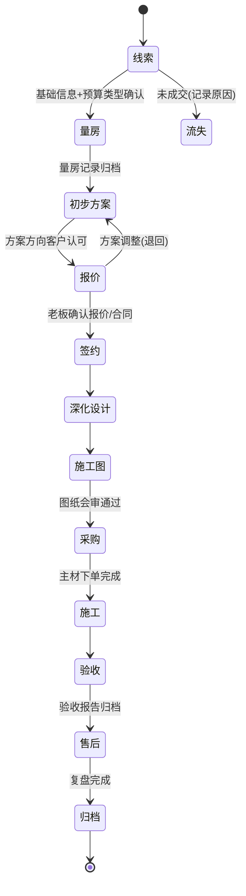

# 二、企业空间项目标准流程与状态机

> 适用范围：办公室、企业空间类项目（MVP 试点）。住宅/餐饮/酒店模板在第 3 个月扩展阶段复制本框架后裁剪。

## 1. 项目编号与基本规则

- 项目编号：`城市码-年份-流水号`，如 `HZ-26-001`（杭州 2026 年第 1 个）、`NB-26-002`、`WZ-26-003`。城市码：HZ 杭州 / NB 宁波 / WZ 温州。编号在签约前（线索转立项时）即分配，终身不变。
- 报价版本：`项目编号-Q01`、`-Q02`……每次对外重新报价递增，不改旧版本数据。
- 问题编号：`WT-26-0001` 起逐年累加；任务编号：`RW-26-0001`；客户编号：`KH-26-001`。

## 2. 项目阶段状态机

## 3. 阶段定义表（准入/工作/输出/责任人/AI 辅助/审批/准出）

| 阶段 | 准入条件 | 主要工作 | 输出交付物（归档到 NAS） | 责任人 | AI 辅助点 | 必须老板审批 | 准出条件 |
|---|---|---|---|---|---|---|---|
| 线索 | 获得客户联系方式与初步意向 | 了解项目基础信息、预算类型 | 客户表登记、需求初记 | 老板 | 客户信息助理自动建档、整理沟通记录 | 是否接项目 | 分配项目编号 |
| 量房 | 编号已分配 | 现场测量、拍照、房屋现状记录 | 02_现场测量：量房记录、现状照片 | 助理设计师 | 需求分析助理把语音/照片记录转结构化量房记录 | — | 量房记录归档 |
| 初步方案 | 量房记录归档 | 平面布局、方向沟通 | 03_设计方案：方案文件、汇报文案 | 老板（主案） | 设计协同助理生成需求简报、参考方向、汇报文案初稿 | 设计方向 | 客户认可方向 |
| 报价 | 方向认可 | 选模板、列项、询价、定价 | 06_报价与合同：报价 Qxx | 报价助理+老板 | 报价助理生成清单草案、查漏项、异常单价检查 | 正式报价 | 老板签发报价版本 |
| 签约 | 报价确认 | 合同谈判、签约 | 设计/施工合同扫描件 | 老板 | 项目经理助理登记里程碑与关键节点 | 合同条款 | 合同归档、项目表更新 |
| 深化设计 | 合同生效 | 方案深化、材料初选 | 03/04/07 目录深化文件 | 助理设计师 | 设计任务单驱动；材料知识助理查材料与供应商 | 材料品牌 | 深化图纸内部评审通过 |
| 施工图 | 深化通过 | 施工图绘制、会审 | 05_CAD施工图（版本化） | 施工图设计师 | AI 检查图纸版本命名与归档；变更记录关联 | — | 图纸会审通过 |
| 采购 | 图纸会审通过 | 询价、比价、打样、下单 | 07_材料与供应商：订单与跟进记录 | 采购责任人（默认助理） | 供应商助理生成任务、到期提醒、逾期升级 | 价格超阈值/换品牌 | 主材下单完成 |
| 施工 | 主材下单 | 现场施工、问题整改、进度汇报 | 08_施工进度：日报、问题记录、照片 | 外包施工+采购责任人 | 施工问题助理登记分派提醒；项目经理助理出周报 | 施工质量认定/重大变更 | 验收清单全部关闭 |
| 验收 | 施工完成 | 分区验收、整改、结算 | 10_验收与售后：验收单 | 老板 | 项目经理助理生成验收清单与差异报告 | 验收结论 | 验收报告客户签字 |
| 售后 | 验收通过 | 保修跟进、客户回访 | 10_验收与售后：售后记录 | 老板 | 系统按保修期自动提醒回访 | 退款/赔偿 | 回访完成 |
| 归档 | 售后结束 | 资料齐套检查、复盘 | 全目录 + 复盘报告 | 助理设计师 | 项目经理助理生成复盘报告与利润核算 | — | 资料完整率≥90% |

## 4. 项目状态字段（与 `02_数据模板/01_客户与项目表.xlsx` 项目表一致）

- **当前阶段**（单选）：线索 / 量房 / 初步方案 / 报价 / 签约 / 深化设计 / 施工图 / 采购 / 施工 / 验收 / 售后 / 归档
- **项目状态**（单选）：进行中 / 暂停 / 已完成 / 已取消 / 已流失（仅线索阶段）

阶段只能按状态机顺序前进；退回（如报价→初步方案）须记录原因；任何阶段可将项目置为"暂停/已取消"并记录原因。

## 5. 企业空间项目信息采集表（立项时必填）

企业空间与住宅差异大，立项时在"项目表"补充以下采集字段（对应交接说明第 4 节清单）：

| 分组 | 采集字段 |
|---|---|
| 企业信息 | 企业名称、行业、品牌与业务定位、企业文化关键词 |
| 空间与人数 | 总面积、使用人数、部门清单、各部门空间功能与面积需求 |
| 动线要求 | 客户动线、员工动线、访客动线、特殊动线（如实验室/直播间） |
| 房屋条件 | 楼盘地址、楼层、房屋现状（毛坯/遗留装修）、层高、承重限制 |
| 外部约束 | 房东要求、物业规定（施工时间/电梯/货梯）、消防报审要求、机电容量、空调系统限制 |
| 时间要求 | 期望开业/启用日期、倒排关键节点（设计完成、进场、竣工） |
| 预算 | 总预算、预算上限、预算分配倾向（形象区/办公区/会议区） |
| 决策链 | 决策人、使用人代表、审批人、各自关注点 |
| 保留项 | 必须保留的设备/设施/家具清单 |
| 节点约定 | 设计审批节点、施工与采购节点、变更签证与验收节点 |

## 6. 阶段与 NAS 目录对应

| 阶段 | 归档目录（项目文件夹内） |
|---|---|
| 线索/签约 | 01_客户资料 |
| 量房 | 02_现场测量 |
| 初步方案/深化设计 | 03_设计方案 |
| 效果图 | 04_效果图 |
| 施工图 | 05_CAD施工图 |
| 报价/合同 | 06_报价与合同 |
| 采购 | 07_材料与供应商 |
| 施工 | 08_施工进度 |
| 变更与问题 | 09_变更与问题 |
| 验收/售后 | 10_验收与售后 |

命名规范见 `05_NAS文件结构/01_命名与文件夹规范.md`。
