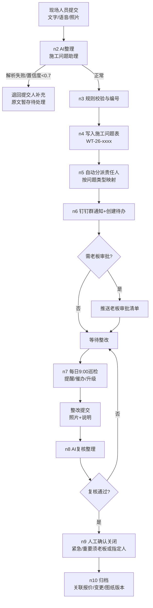
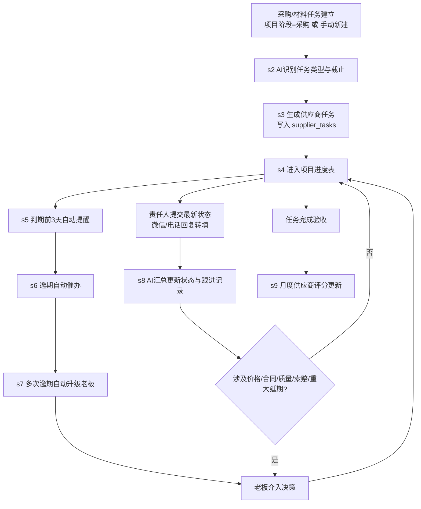
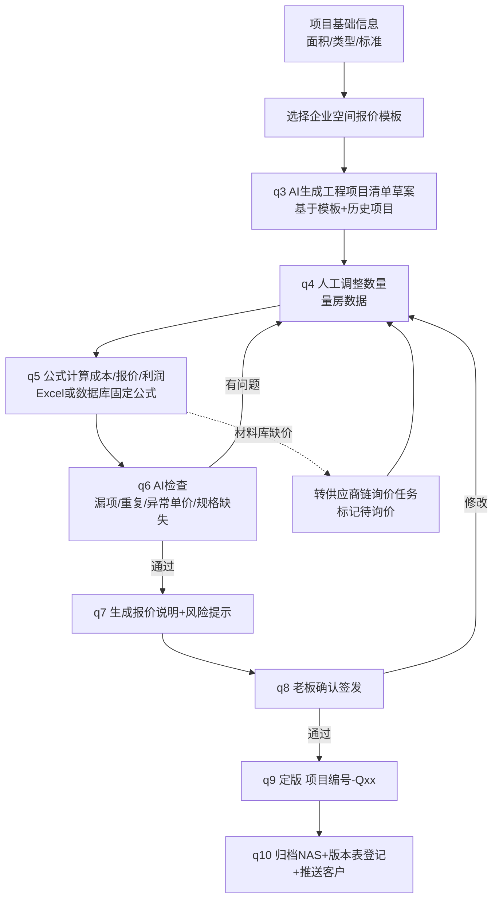

# 三、三大工作链节点设计（MVP 核心）

> 本文是 MVP 的实施蓝图：每条链给出触发方式、输入、AI 处理、数据库写入、钉钉动作、审批节点、异常分支和输出。节点编号用于与 `04_自动化工作流/` 中 n8n 工作流一一对应。

## 0. 全链通用约定

### 0.1 提醒与升级时间线（全系统统一）

| 事项类型 | 提前提醒 | 到期未完成 | 逾期 1 天 | 逾期 3 天 |
|---|---|---|---|---|
| 施工问题（一般/重要） | 截止前 1 天 9:00 提醒责任人 | 提醒责任人+抄送群 | 催办责任人并@ | 升级老板 |
| 施工问题（紧急） | 立即通知 | 当日 9:00 与 17:00 双提醒 | 升级老板 | —（已升级） |
| 供应商任务 | 要求交付日前 3 天提醒责任人 | 提醒责任人 | 催办供应商+@责任人 | 升级老板 |
| 待老板审批事项 | 生成即推送 | 每日 9:00 重复出现在审批清单 | 第 3 天标红 | 每周五周报置顶 |

### 0.2 审批红线（触发即进老板待审批清单，AI 不得自动通过）

- 严重程度=紧急的施工问题；或影响成本/工期/设计效果=是 的重要问题。
- 供应商事项：报价浮动超上次 ±10%、更换材料品牌、索赔/退款、延期影响合同工期节点。
- 报价：正式报价版本签发；毛利率低于阈值（默认 25%，可在报价模板中调整）。
- 其余红线（接单、设计方向、合同条款、质量认定、客户投诉、退款赔偿）见 `07_风险与安全/自动化边界与数据安全.md`。

### 0.3 数据写入规则

- 所有记录先写数据库（快速版为 Excel/钉钉表格，稳定版为 PostgreSQL，表结构见 `02_数据模板/00_数据字典.md` 与 `db_init.sql`），再触发通知。**通知失败不丢数据**（n8n 重试 3 次，失败转人工通道）。
- AI 输出必须带 `confidence`（置信度）；低于 0.7 的字段标记"待人工确认"，不得静默采用。

---

## 1. 施工问题管理链（最优先上线）

**目标**：老板从"整理现场问题、追问责任人、催办"中退出，只处理紧急项和审批项。

### 1.1 流程图

### 1.2 节点设计表

| 节点 | 触发方式 | 输入 | 处理 | 数据写入 | 钉钉动作 | 异常分支 |
|---|---|---|---|---|---|---|
| n1 提交 | 钉钉宜搭表单（快速版）/ n8n Webhook（稳定版）；支持拍照、语音转文字 | 提交人、项目、描述、照片 | — | — | — | 离线时先拍照后补录，24h 内有效 |
| n2 AI 整理 | 表单提交触发 | 原始描述+照片 | 施工问题助理：提取问题类型/严重程度/影响项/责任方初判，生成标准描述 | 草稿态字段+AI 置信度 | — | 解析失败→原文+照片转"待整理"队列，@提交人补充 |
| n3 校验编号 | AI 整理完成 | n2 输出 | 必填校验（项目、类型、描述、截止时间默认规则：紧急 24h、重要 3 天、一般 7 天）；生成编号 | 问题编号 | — | 缺责任人映射→默认采购责任人并标记 |
| n4 入库 | 校验通过 | 全字段 | 写入 `issues` 表，状态=待处理 | `issues` | — | 数据库失败→暂存队列+告警管理员 |
| n5 分派 | 入库后 | 问题类型/责任方 | 按映射表分派：尺寸/图纸→施工图设计师；材料/工艺/质量→施工方负责人+采购责任人；进度→采购责任人；客户变更→老板 | 责任人字段 | 群消息@责任人 | 紧急→同时@老板（无需等待巡检） |
| n6 待办 | 分派后 | 责任人、截止 | — | 状态=处理中 | 钉钉群卡片+待办（稳定版用待办 API） | 机器人限流→重试 3 次→短信/电话兜底由责任人手动 |
| n7 巡检 | 每日 9:00 定时 | 全部未关闭问题 | 按 0.1 时间线生成提醒/催办/升级三类消息 | 逾期次数+1、状态=已升级 | 分级@（责任人→+老板） | 无未关闭项→发"全部正常"简报（保持信任） |
| n8 整改提交 | 责任人表单 | 照片+说明 | 施工问题助理对比前后描述，生成复核摘要 | 处理方案、整改照片、状态=待复核 | 通知复核人 | 照片缺失→打回 |
| n9 复核关闭 | 复核人操作 | 复核摘要 | 一般问题：复核人关闭；重要/紧急：老板或指定人关闭 | 状态=已关闭、复核人 | 关闭通知进群 | 复核不通过→退回 n5 重分派并记录 |
| n10 归档 | 关闭后 | 完整记录 | 关联报价版本/变更单/图纸版本号；照片归档 NAS `09_变更与问题` | 关联字段 | — | — |

### 1.3 状态机（`issues.处理状态`）

`待处理 → 处理中 → 待复核 → 已关闭`；异常分支：`待整理`（AI 失败暂存）、`已升级`（逾期升级中，整改后回处理中）。

---

## 2. 供应商跟进链

**目标**：询价、打样、排产、发货、安装、整改全流程任务化，系统自动提醒催办，老板只收异常。

### 2.1 流程图

### 2.2 节点设计表

| 节点 | 触发方式 | 输入 | 处理 | 数据写入 | 钉钉动作 | 异常分支 |
|---|---|---|---|---|---|---|
| s1 任务建立 | 项目进入采购阶段自动生成 / 手动表单新建 | 项目、材料需求清单 | — | `supplier_tasks` 新建（状态=询价中） | 通知采购责任人 | 材料库无此材料→同步生成询价任务并在报价模板标"待询价" |
| s2 AI 识别 | 任务建立触发 | 任务描述 | 供应商助理识别任务类型、建议供应商（按类别+区域+评分排序）、推算截止 | 建议供应商、截止日期 | — | 无匹配供应商→标记"新供应商待评估"，走准入登记 |
| s3 生成任务 | s2 后 | 全字段 | 校验供应商存在、截止不早于常规交付周期 | 状态=询价中 | 责任人待办 | — |
| s4 进度关联 | 任务生效 | 任务 | 更新项目表"采购进度"汇总（主材下单率） | `projects.采购进度` | — | — |
| s5 提醒 | 每日 9:00 巡检 | 全部未完成任务 | 交付前 3 天→提醒责任人跟进 | 跟进记录 | @责任人 | — |
| s6 催办 | 巡检 | 逾期任务 | 逾期 1 天→催办供应商（责任人转发标准催办话术）+@责任人；逾期次数+1 | 逾期次数、状态=逾期 | 群消息 | — |
| s7 升级 | 巡检 | 逾期≥3 天或累计≥2 次 | 升级老板，附供应商历史数据卡（准时率、历史逾期、质量问题） | 状态=已升级 | @老板 | 涉及合同工期→同时标红项目风险 |
| s8 状态回填 | 责任人表单提交 | 微信/电话/口头回复内容 | 供应商助理：解析回复→更新状态与预计时间→生成跟进记录；价格变动自动比对上次报价 | 状态流转、跟进记录、价格 | 超阈值→推送老板审批 | 解析失败→原文转人工 |
| s9 评分更新 | 每月 1 日 | 上月完成任务 | **公式计算**（非 AI）：准时交付率=按期完成数/总完成数；更新质量/配合度均分 | `suppliers` 评分字段 | 群发布供应商月报 | 无记录供应商跳过 |

### 2.3 供应商任务状态机（`supplier_tasks.状态`）

`询价中 → 已报价 → 已下单 → 生产中 → 已发货 → 已到货 → 已安装 → 已完成`
分支：`询价中→已取消`（弃用）、`已安装→整改中→已完成`、任意态→`逾期`/`已升级`（整改后回到原状态并累计逾期次数）。

### 2.4 升级老板的数据卡（自动生成）

供应商名称、类别、合作次数、近 6 个月准时交付率、累计逾期次数、历史质量问题摘要、本次逾期任务与影响、建议动作（催办/换供应商/索赔）。

---

## 3. 报价标准化链

**目标**：把"老板凭经验每次重填"改为"模板+数据库+固定公式"驱动；AI 只做草案、检查和解释，**不计算金额**。

### 3.1 流程图

### 3.2 节点设计表

| 节点 | 触发方式 | 输入 | 处理 | 数据写入 | 钉钉动作 | 异常分支 |
|---|---|---|---|---|---|---|
| q1 信息录入 | 项目进入报价阶段 | 面积、空间分区、标准档位 | 项目经理助理检查信息完整度 | — | 缺项清单@老板/助理 | — |
| q2 选模板 | 手动 | 项目类型=企业空间 | 加载 `05_报价模板_企业空间.xlsx` 最新版 | 报价版本=草稿 | — | — |
| q3 AI 草案 | q2 触发 | 模板+3 个历史企业空间项目清单 | 报价助理生成工程项目与材料清单草案（含默认规格） | 明细行（草稿） | — | AI 不填价格，价格一律来自材料/项目库；库里没有→标"待询价" |
| q4 数量调整 | 人工（助理/老板） | 量房记录 | 人工填数量与损耗 | 明细行数量 | — | — |
| q5 公式计算 | 数量变更自动（Excel） | 明细 | **固定公式**：综合单价=人工+材料单价；合价=数量×(1+损耗)×综合单价；成本、毛利、毛利率同理（见模板公式列） | 计算列 | — | 禁止手改公式列（模板锁定） |
| q6 AI 检查 | q5 后手动触发 | 明细+检查清单+材料库 | 漏项（对照企业空间分部检查清单）、重复项、异常单价（偏离材料库或历史 ±20%）、规格缺失 | 检查报告 | 推送报价责任人 | 无问题→直接 q7 |
| q7 说明生成 | q6 通过 | 明细+项目信息 | 生成报价说明、含项/不含项边界、风险提示（如消防报审、物业限制） | 报价说明 | — | — |
| q8 老板签发 | 人工触发 | 完整报价 | 老板逐项确认或批注修改 | 版本状态=待审批→已确认 | 审批清单+结果通知 | 毛利率<阈值→标红提示，由老板决定是否放行 |
| q9 定版 | 签发通过 | 全部数据 | 版本号 Qxx 递增，旧版本锁定只读 | `quote_versions` | — | — |
| q10 归档 | 定版后 | 文件 | PDF+Excel 归档 NAS `06_报价与合同`，命名 `项目编号-Qxx-日期` | 版本表登记 | 通知相关人 | — |

### 3.3 报价检查清单（q6 的 AI 依据，随模板维护）

- 分部完整性：隔墙、水电、地面、墙面、天花、门窗、家具定制、灯具照明、五金洁具、空调消防配合、软装配饰、拆除与保护、垃圾清运、设计费与管理费——13 个分部逐一比对是否漏项。
- 重复项：同一区域同一工艺出现两次及以上。
- 单价异常：与材料库/近 3 次同类型项目偏差超 ±20%。
- 规格缺失：有数量无规格说明，或有品牌无型号。
- 边界完整：报价说明是否写明含项/不含项、水电按实结算口径、变更签证规则。

### 3.4 数据表支撑

工程项目表、材料表、供应商价格表、报价模板表、报价版本表、成本利润表——字段定义见 `02_数据模板/00_数据字典.md`；Excel 落地为 `05_报价模板_企业空间.xlsx` 与 `06_报价版本与利润表.xlsx`。

---

## 4. 三链共用异常处理原则

1. **AI 失败不阻塞业务**：任何 AI 节点失败/低置信度，都退回人工通道（待整理队列），原始数据不丢失。
2. **通知失败不丢数据**：先写库后通知；通知渠道失败降级为群内告警。
3. **所有升级必有记录**：升级老板的消息必须附带结构化数据卡，不允许"只喊人没信息"。
4. **试点期双人核对**：前 2 周 AI 整理结果由提交人当场确认字段再入库，2 周后视准确率（目标 ≥90%）切全自动。
