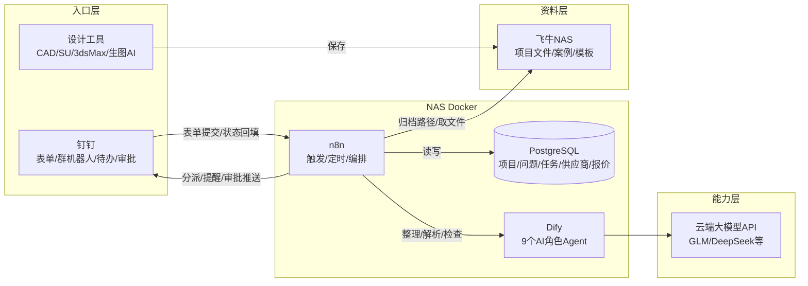
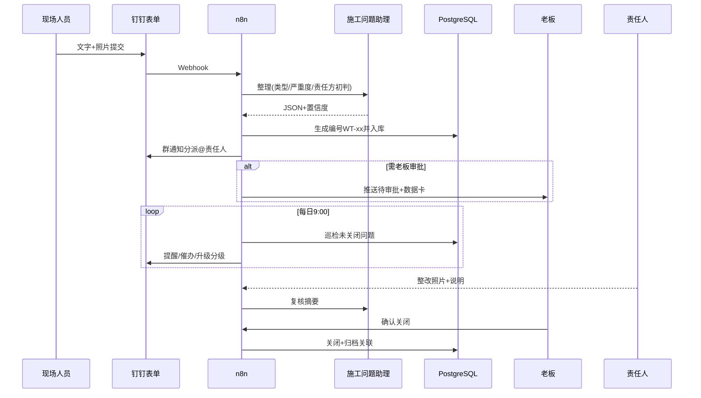

# 十二、系统架构图与三阶段演进

## 1. 目标架构（稳定内用版，第 3~6 周）

## 2. 数据流示例：一条施工问题的完整旅程

## 3. 三阶段架构演进

| 阶段 | 架构 | 说明 |
|---|---|---|
| 快速版（第 1~2 周） | 钉钉宜搭表单 + 群机器人 + Excel 模板（本包 02 目录） | 零部署，人工巡检；数据结构与数据库同构，迁移零改造 |
| 稳定内用版（第 3~6 周） | 上图全架构 | n8n 编排 + PostgreSQL 主数据 + Dify Agent + NAS 文件中心 |
| 定制扩展版（第 2 个月起） | 增加钉钉自建应用（待办/审批 API）、住宅模板、案例知识库、利润复盘 | 前两阶段的数据与流程全部复用，只加不改 |

## 4. 与候选架构（交接说明第 3 节）的对应

| 候选组件 | 本方案落地 |
|---|---|
| 钉钉 = 协同入口 | 级别 0~2 渐进接入（群机器人→宜搭→待办/审批 API） |
| 飞牛 NAS = 资料中心 | 标准目录结构 + 命名规范 + 备份策略；同时承载 Docker 运行时 |
| 项目数据库 | PostgreSQL（db_init.sql）+ Excel 快速版镜像 |
| Dify = AI 平台 | 9 个角色 Agent；若无条件部署 Dify，可用云 API+固定提示词等价实现（工作流已内置精简提示词） |
| n8n = 自动化 | 3 条工作链 JSON，定时+Webhook 双触发 |
| 云端大模型 | 环境变量配置，可随时更换供应商，不绑定 |
