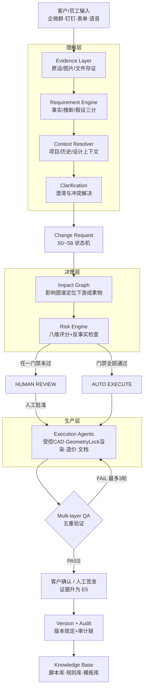

# 设计操作系统 · 00 总纲（Evidence-Driven AI Design OS）

> **核心原则只有一句：AI 永远不能因为"听起来合理"就把它当成事实。**
> 系统的可靠性不来自模型，来自我们自己的规则、数据结构、证据链和审批机制。模型可换（GPT/Claude/GLM/Qwen），这套结构是公司资产。

## 1. 定位

在已有底座（钉钉、飞牛 NAS、PostgreSQL、n8n、Dify、施工问题/供应商/报价三链）之上，建设**证据驱动的 AI 室内设计操作系统**：需求从客户群进入，经证据存证、严谨理解、影响推理、受控生产、多重验证、人工签发，最终变成图纸、效果图、报价和施工指令——每一步可追溯，每个结论有出处。

与上一版"AI 设计生产线"方案相比，本版按评审意见做四处根本修正：

| # | 上一版 | 本版（修正后） |
|---|---|---|
| 1 | "DWG 是黑盒，AI 不能直接改"（说过头了） | **AI 不应自由编辑 DWG，但由结构化设计数据/规则生成变更指令，再由受控 CAD Agent 通过 AutoCAD API（.NET/ObjectARX/Automation API、AutoLISP、AccoreConsole）执行创建、读取和修改。** DWG 不给 LLM 自由发挥，但完全可程序化操作 |
| 2 | A/B/C 三级分类（单维度） | **Change Risk Score 八维评分 + 门禁条件集**，多维度定路由，废除纯金额门槛 |
| 3 | 六个 AI 工位 | **四层 AI：理解层 / 决策层 / 生产层 / 验证层**，签发层永远是人 |
| 4 | "金额 < 2000 且不碰结构 → 自动执行" | 废除。自动执行 = 风险×证据×影响×可逆性×施工阶段×客户确认×策略的**布尔门禁**（见 03 文档），¥500 换灯也可能因涉及吊顶/电路/消防而进人工 |

## 2. 六层价值链

```text
需求证据层 → 设计事实层 → 变更推理层 → 生产执行层 → 多重验证层 → 人工签发层
（版本 Version + 审计 Audit + 知识库 Knowledge 贯穿全程）
```

| 层 | 职责 | 对应文档 |
|---|---|---|
| 需求证据层 | 原话/图片/文件存证；语义解析；实体提取；上下文关联；意图判断；约束识别；冲突检测；事实/推断/假设分离；不确定性评估；澄清问题生成 | 01、02 |
| 设计事实层 | Design Hub 作为唯一事实源（Single Source of Truth）；每个设计对象带 Provenance（来源证据）与 Version（版本不覆盖）；影响图谱（Dependency Graph） | 04 |
| 变更推理层 | Request→Requirement→Change 三段式；Change Risk Score 八维评分；自动执行门禁；审批引擎 | 02、03 |
| 生产执行层 | CAD（五级执行阶梯+五道门）、效果图（Geometry Lock）、造价（公式）、文档报告 | 05 |
| 多重验证层 | Design QA / Drawing QA / Geometry QA / Cost QA / Construction QA；施工证据闭环；责任边界 | 06 |
| 人工签发层 | 方向关、签发关、客户确认关；签章责任在人（法规） | 03 |

## 3. 四层 AI（替代"六个工位"的表述）

| AI 层 | 只负责 | 绝不负责 |
|---|---|---|
| 理解层 | Evidence / Requirement / Context / Intent / Authority / Ambiguity / Conflict | 不做任何决定 |
| 决策层 | Impact / Risk / Cost / Schedule / 设计与施工影响分析、反事实检查 | 不放行任何变更 |
| 生产层 | CAD 指令（受控）、渲染任务组装、量差计算输入、报告生成 | 不直接碰生产文件（必须经执行代理）、不算最终金额 |
| 验证层 | 五重 QA、几何一致性、证据充分性检查 | 不代替人验收、不指挥施工队 |

签发层（老板/客户决策人/注册责任人）**没有 AI**。

## 4. 总架构图



## 5. 核心对象与引擎（本目录其余文档逐一展开）

| 对象/引擎 | 一句话定义 | 文档 |
|---|---|---|
| Evidence Object | 每条信息带来源与证据等级（E0~E5），append-only 不可篡改 | 01 |
| Requirement Object | 客户真正需要什么（经澄清确认），与"客户说了什么"分离 | 02 |
| Change Object（CR） | 经设计判断后实际要改什么；S0~S8 状态机驱动 | 03 |
| Design Object | 设计事实的最小单元，带 Provenance + Version | 04 |
| Impact Graph | 设计对象 → 下游成果物（图/渲染/材料表/报价/采购/工期）的关系图 | 04 |
| Risk Engine | 八维评分 + 门禁布尔条件，决定 AUTO / HUMAN | 03 |
| Approval Engine | 按权限矩阵（Authority Matrix）+ 风险 flag 确定审批人，全程留痕 | 02、03 |
| QA Engine | 五重验证 + 施工证据闭环，PASS/WARNING/HUMAN_REVIEW 三态 | 06 |

## 6. 与现有系统的关系（不推倒重来）

- **复用**：钉钉（入口/通知/审批）、NAS（证据与成果物存档）、PostgreSQL（新增 `design_os` schema，见 07）、n8n（新增 OS 工作流）、Dify（四层 Agent 承载）。
- **升级**：施工问题链 → 叠加施工证据闭环（06 文档第 3 节）；报价链 → 变更为造价联动站（05 文档第 4 节）；审批表 → 接 Authority Matrix。
- **新增**：企微 AI 客服入口（个人微信无官方接口，不做协议破解）、工作站执行代理（一台 Windows 设计机上的常驻服务，唯一有权操作 CAD/渲染器的进程）。

## 7. 本目录文档清单

| 文件 | 内容 |
|---|---|
| 00_总纲 | 本文 |
| 01_证据系统 | 证据源分类、E0~E5 等级、事实/推断/假设三分法、存证规范 |
| 02_需求智能层 | 11 步管线、Request/Requirement/Change、权限矩阵、澄清与反事实检查 |
| 03_变更对象与状态机 | CR 结构、S0~S8、Change Risk Score、自动执行门禁、审批引擎 |
| 04_设计事实层 | Design Hub、Provenance、Version、影响图谱、变更影响报告 |
| 05_生产执行层 | CAD 五级阶梯+五道门、受控 CAD Agent、Geometry Lock 渲染、造价联动 |
| 06_验证层 | 五重 QA、几何一致性检查、施工证据闭环、责任边界矩阵 |
| 07_数据模型 | PostgreSQL DDL（design_os schema） |
| 08_Agent提示词 | 四层 AI 全部提示词与输出格式、全局证据红线 |
| 09_实施路线 | 三阶段落地 + 与 30/90 天计划衔接 + 待确认决策 |
