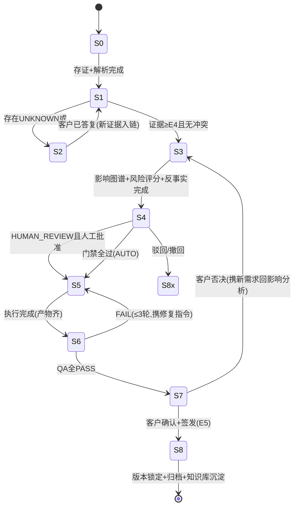

# 设计操作系统 · 03 变更对象与状态机（Change Object + S0~S8）

> 目标：AI 不会因为"理解了一句话"就直接开始改图。每个变更走完 S0~S8 状态机，路由由八维风险评分+门禁布尔条件决定，废除纯金额门槛。

## 1. Change Object（CR）结构

| 字段组 | 字段 |
|---|---|
| 标识 | cr_id（CR-26-0001）、project_no、requirement_id、来源 Request 列表 |
| 内容 | 变更对象清单（Design Object ID + 属性旧值/新值）、变更理由、设计选项与客户选择记录 |
| 证据 | 支撑证据 ID 列表、证据等级（就低） |
| 风险 | 八维评分、结构/机电/消防/工期关键 flag、反事实检查结果 |
| 路由 | AUTO_EXECUTE / HUMAN_REVIEW、门禁条件逐项通过记录 |
| 状态 | 当前状态（第 2 节）、状态日志（谁、何时、为什么转移） |
| 执行 | 执行方式（05 文档五级阶梯）、产出物清单（图/渲染/报价/报告）、QA 结果 |
| 签发 | 审批人（按权限矩阵）、客户确认证据、签发时间 |
| 版本 | design_version_from → design_version_to、审计链 ID |

## 2. 状态机：S0~S8（含细粒度状态）



| 阶段 | 细粒度状态 | 准出条件 | 超时规则 |
|---|---|---|---|
| S0 受理 | NEW → PARSED | 证据落库+语义解析成功 | 30 分钟内无解析→人工 |
| S1 理解 | NEEDS_CLARIFICATION ⇄ CLARIFIED | FACT/INFERENCE/ASSUMPTION 分离完成，证据 ≥E4，权限核验通过 | 澄清 24h 未答→提醒；48h→项目负责人电话 |
| S2 影响分析 | IMPACT_ANALYSIS | 图谱波及清单+八维评分+反事实检查全部留档 | — |
| S3 方案 | PROPOSAL | 修改方案/选项+变更影响报告生成 | — |
| S4 审批 | PENDING_APPROVAL → APPROVED | 门禁全过(AUTO)或有权签发人批准 | 3 天未批→每日提醒；第 5 天置顶周报 |
| S5 执行 | EXECUTING | 五级阶梯执行完，产物登记 | 执行 2h 无心跳→告警实施人员 |
| S6 质检 | QA | 五重 QA 全 PASS（06 文档） | FAIL≤3 轮；超限→人工队列+沉淀 |
| S7 客户确认 | CUSTOMER_CONFIRMATION → SIGNED | 决策人确认（权限矩阵核验）→ 证据升 E5 | 48h 未确认→AI 客服跟进→电话 |
| S8 关闭 | CLOSED | 版本锁定、审计链完整、通知下游（施工/采购/报价） | — |

驳回/撤回（S4 或 S7 否决）→ 记录原因 → 回 S2（新信息）或 CLOSED_CANCELLED。

## 3. Change Risk Score：八维评分（替代 A/B/C）

| 维度 | 低(1) | 中(2) | 高(3) |
|---|---|---|---|
| Scope 范围 | 单一对象局部 | 多对象/单区域 | 跨区域/整层 |
| Risk 风险 | 无安全/结构/机电/消防涉及 | 间接涉及需复核 | 直接涉及任一 |
| Cost 成本 | ±＜1‰合同额 | 1‰~1% | ＞1% |
| Schedule 工期 | 不影响 | 非关键路径受影响 | 关键路径受影响 |
| Design Impact | 材质/色彩/软装 | 布局局部/点位 | 功能重排/风格转向 |
| Construction Impact | 未施工或可逆施工 | 已施工需局部返工 | 已施工且返工量大 |
| Reversibility 可逆性 | 完全可逆（数据/未下单） | 需重新采购 | 不可逆（凿墙/已定制） |
| Evidence 证据完整度 | ≥E4 且图谱完整 | E3 或图谱部分缺失 | ≤E2 |

四个独立 flag（任一为真直接 HUMAN_REVIEW，不走分数）：`STRUCTURAL / MEP / FIRE / SCHEDULE_CRITICAL`。

**评分只用于排序与展示，放行只看门禁（第 4 节）**——防止"分数好看但踩红线"。

## 4. 自动执行门禁（布尔条件集，废除金额门槛）

只有**同时满足全部条件**才允许 AUTO_EXECUTE，否则一律 HUMAN_REVIEW：

```text
Risk(风险维) = 低
AND Evidence ≥ E4
AND 无 STRUCTURAL 影响
AND 无 MEP（机电）影响
AND 无 FIRE（消防）影响
AND 无 SCHEDULE_CRITICAL（关键工期）影响
AND Reversibility = 可逆
AND Customer Confirmed = 是（S4 前需客户预确认，S7 终确认）
AND 反事实检查 6 条全部为"否"
AND Design Director AutoApproval Policy = 允许（按变更类型配置的白名单）
```

### 为什么金额不能当门槛（评审意见采纳）

- ¥500 换一盏灯：可能涉及吊顶开孔、电路回路、消防感应器移位、采购下单——四维全高，**不得自动**。
- ¥5000 换沙发颜色：范围小、可逆、不碰施工——门禁可全过，**可以自动**。

结论：金额只是 Cost 维度的输入之一，永远不单独决定路由。

## 5. Approval Engine（审批引擎）

1. 审批人由 **权限矩阵 × 风险 flag** 决定：默认项目负责人；碰任一 flag → 加签老板；对外报价变动 → 加签老板（签发关）。
2. 审批对象不是"一句话"，而是**变更影响报告**（04 文档第 5 节格式）：老板一眼看到新旧值、波及产物、量价工期影响、证据链。
3. 每次审批写 approvals 表：审批人、权限角色、决定、意见、时间、依据的证据 ID——构成 E5 证据。
4. AUTO_EXECUTE 的变更也生成"事后告知卡"（附影响报告），老板可 24h 内叫停（叫停即回滚到上一 Design Version，可逆性门禁保证了这一点可执行）。

## 6. 与既有三链的联动

- CR 进入 S8 → 涉及材料的自动生成供应商任务（询价/改单），走供应商链提醒升级规则。
- CR 涉及已施工部位 → 自动创建施工问题（WT）挂接整改流程，**AI 只登记与建议，由项目负责人确认后才通知施工队**（责任边界见 06 文档）。
- CR 产生量差 → 造价联动（05 文档）生成变更报价单 CQ-xx，进报价链签发流程。
